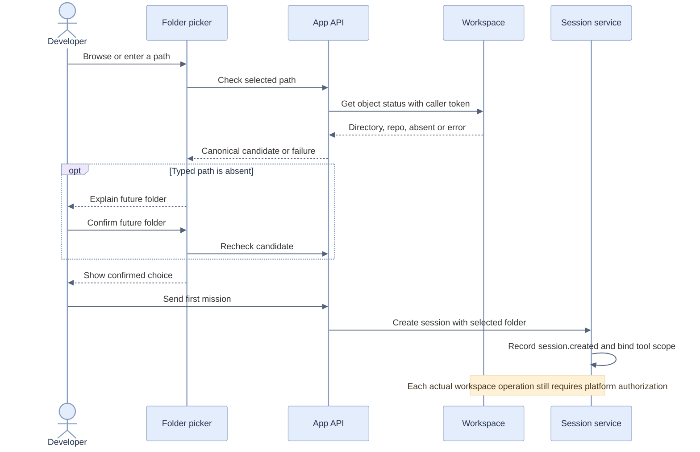
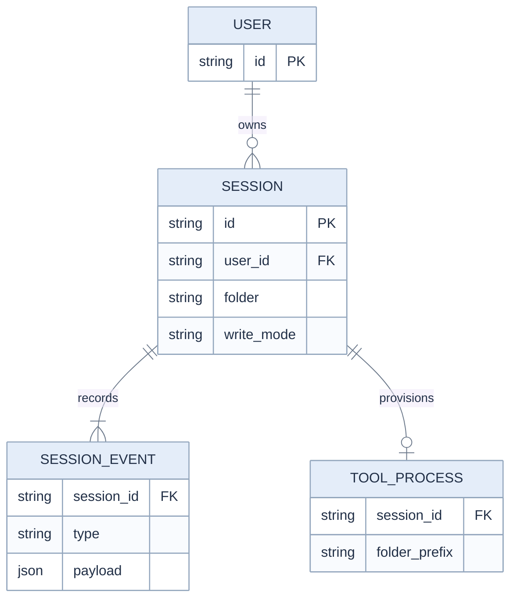
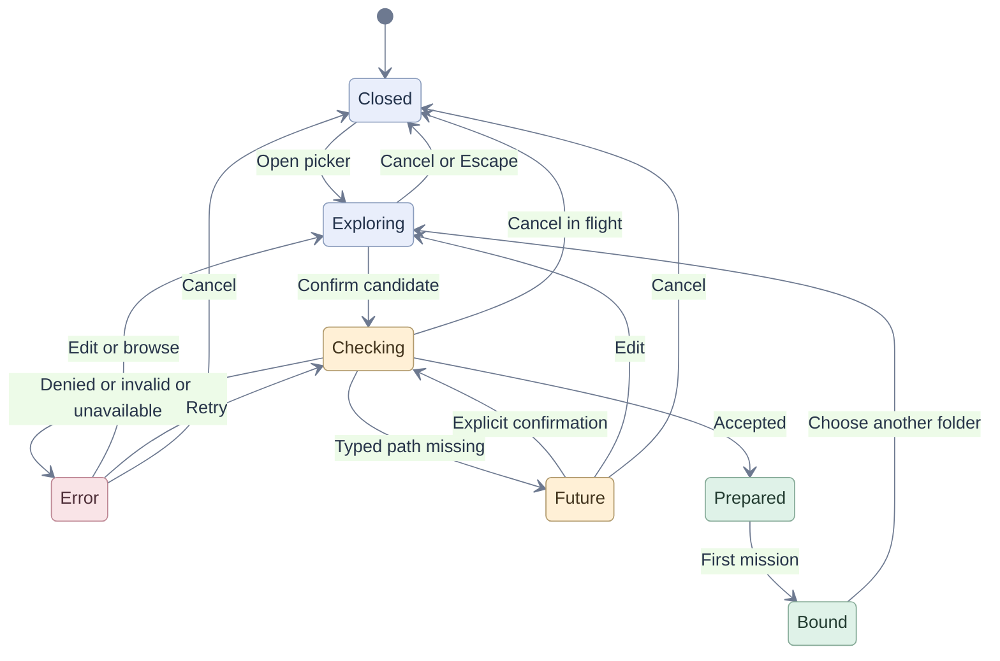

# Runtime and data design

The [product contract](interaction.md#acceptance-contract) treats a folder choice as a draft until a message starts a session. The [implementation plan](plan.md) identifies the owners of each transition.

## Selection and first send

The workspace browser checks object metadata through the existing caller-token adapter. A positive result identifies a directory or repo. Existence and access can change after the check. Each later operation resolves its target under the session fence and Databricks checks its permissions at execution. See the [API route](../../apps/coding-agent/api/routers/api.py) and [workspace adapter](../../apps/coding-agent/api/adapters/databricks/workspace.py).

## Session and workspace data

This is a logical model. The process is ephemeral. The existing session-created event persists the folder and supports replay. Browser selection is scoped to the current account and workspace for this page lifetime. Reloading a saved session reads its recorded path. A fresh home page starts from the signed-in user’s scratch folder. Picking again requires no schema migration or update of earlier journal rows. See [session creation and recovery](../../apps/coding-agent/api/services/session_service.py) and [runtime provisioning](../../apps/coding-agent/api/services/provisioning.py).

## State transitions

Cancellation aborts the metadata request. A listing belongs to one location and query. Replacing it unmounts the earlier request, so stale results cannot become actionable. A submitted mission holds its start lock while the session handoff completes. The [E2E matrix](e2e/README.md) exercises the user-visible transitions.

## Complexity

Browsing requests one level with N direct children. Folder filtering and rendering cost O(N), and the existing adapter orders a directory in O(N log N). Typing a path costs O(L) for path length L and a constant number of status calls per confirmation. A 280 ms debounce precedes search. The existing breadth-first search caps depth at 4, visited directories at 120, results at 40 and checks an eight-second deadline between batches. An upstream request can outlast that deadline. Directory fan-out still affects payload size and DOM cost. No recursive client-side folder index or workspace-wide persistent cache is introduced.
