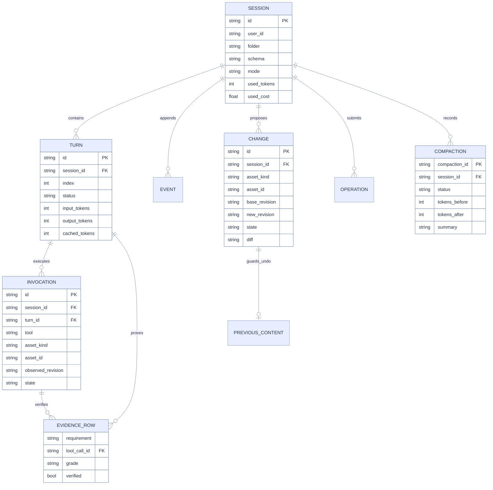
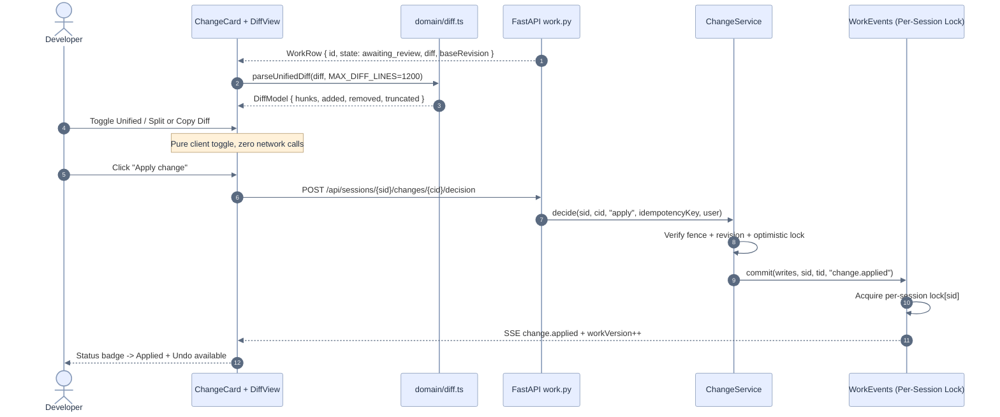
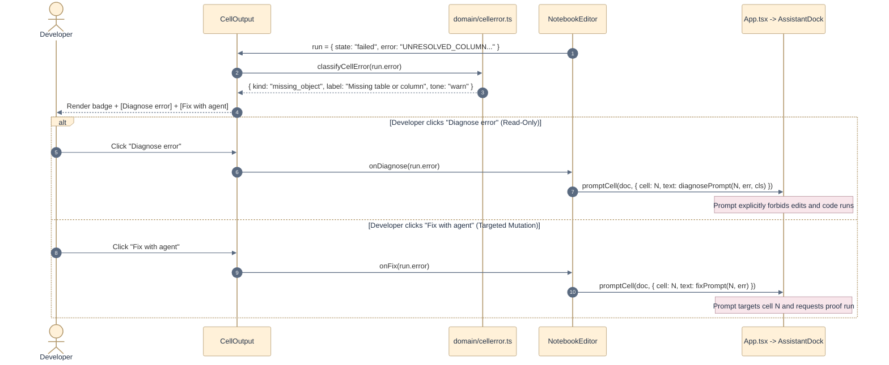

# 05 — Architecture, data model & sequence flows

[Index](README.md) · Previous: [04 — UX wireframes](04-ux-wireframes.md) · Next: [06 — Statecharts](06-statecharts.md)

## DRY & SOLID boundary design

OpenGenie enforces hexagonal separation (`domain/` pure logic, `ports/` interfaces, `services/`
orchestration, `adapters/` external I/O, `routers/` HTTP transport). Spec `017` extends that exact
architecture without creating duplicate state owners:

| Layer | New / Updated Module | Single Responsibility (SRP) | Dependency Direction |
|---|---|---|---|
| Front-end domain | `web/src/domain/diff.ts` | Single-pass O(n) unified diff parser, line-number assigner, split-row aligner, and line-cap truncation. | Zero React/DOM imports |
| Front-end domain | `web/src/domain/contextmeter.ts` | Context pressure tier (`healthy`/`elevated`/`critical`/`unknown`), cache hit-rate math, compactability predicate. | Zero React/DOM imports |
| Front-end domain | `web/src/domain/cellerror.ts` | Pure Databricks error taxonomy classifier (SQL syntax, missing object/column, permission, Python error, timeout, runtime). | Zero React/DOM imports |
| Front-end domain | `web/src/domain/followups.ts` | V1 + V2 tool-aware follow-up suggestion engine (Open/Closed via matcher table). | Depends only on `events.ts` types |
| Front-end domain | `web/src/domain/agentupdates.ts` | Unified compaction reducer handling both ACP block arrays and server `session_compacted` plans. | Pure state transition |
| Front-end UI | `web/src/components/work/DiffView.tsx` | Reusable accessible diff renderer (Unified/Split, Copy Diff, truncation banner). Used by `ChangeCard`. | Depends only on `domain/diff.ts` |
| Front-end UI | `web/src/components/DocContext.ts` | Adds `InsertNotebookCell` React context callback so `Markdown` code blocks bridge to `EditorSurface` without prop-drilling. | Interface Inversion (DIP) |
| Backend domain | `api/domain/events.py` | `session_compacted()` emits canonical `compactionId`, `status`, `tokensBefore`, `tokensAfter`, `kept`, `summarised`, `summary`. | Pure event factory |
| Backend service | `api/services/work_events.py` | Per-session `asyncio.Lock` map eliminates cross-session head-of-line blocking in `flush()`. | Depends only on store port |
| Backend service | `api/services/agent_work.py` | Hash-indexed O(C + O + I) `observation_proof()` verification. | Depends only on store port |
| Backend service | `api/services/turn_service.py` | O(1) `approvals_by_call` lookup index in `_drain()`. | Internal state invariant |
| Backend adapter | `api/adapters/durable/agent_postgres.py` | Single-query `UNION ALL` storage summary in `storage()`. | Implements ledger port |

## Logical entity-relationship model



## Sequence diagrams

### SEQ-1 — Structured diff review & decision flow (`IMP-01`, `IMP-02`, `IMP-06`)



### SEQ-2 — Auditable context compaction roundtrip (`IMP-03`, `IMP-04`, `IMP-05`)

```mermaid
%%{init: {"theme":"base","themeVariables":{"actorBkg":"#F1E9F8","actorBorder":"#A18AB5","actorTextColor":"#243247","signalColor":"#5A6A80","noteBkgColor":"#E4F3EA","noteBorderColor":"#829F8B","noteTextColor":"#243247","activationBkgColor":"#E7EEFF","activationBorderColor":"#879AB8"}}}%%
sequenceDiagram
    autonumber
    actor Dev as Developer
    participant AM as AgentMeter / Composer
    participant API as POST /sessions/{sid}/compact
    participant SS as SessionService.compact()
    participant CP as domain/compaction.py
    participant RED as events.ts -> patchCompaction()

    Dev->>AM: Click "Compact" or submit "/compact"
    AM->>API: POST /api/sessions/{sid}/compact
    API->>SS: compact(sid)
    SS->>CP: plan(turns, budget=window)
    alt Nothing needs shedding
        CP-->>SS: None
        SS-->>AM: { changed: false, reason: "nothing needs shedding" }
        AM-->>Dev: Inline notice: "Context is within budget; nothing to compact."
    else Middle turns shed
        CP-->>SS: Plan(keep, summarise, tokensBefore, tokensAfter)
        SS->>SS: Build structured summary + compactionId
        SS-->>RED: Emit SSE session.compacted { compactionId, status: completed, ... }
        RED->>RED: patchCompaction() stores bounded summary entry
        SS-->>AM: { changed: true, compactionId, tokensBefore, tokensAfter }
        AM-->>Dev: Inline confirmation + AgentUpdates compaction card
    end
```

### SEQ-3 — Cell failure classification: Diagnose vs. Fix (`IMP-08`)



### SEQ-4 — Assistant code block to open notebook cell bridge (`IMP-09`)

```mermaid
%%{init: {"theme":"base","themeVariables":{"actorBkg":"#E4F3EA","actorBorder":"#829F8B","actorTextColor":"#243247","signalColor":"#5A6A80","noteBkgColor":"#E7EEFF","noteBorderColor":"#879AB8","noteTextColor":"#243247","activationBkgColor":"#F1E9F8","activationBorderColor":"#A18AB5"}}}%%
sequenceDiagram
    autonumber
    actor Dev as Developer
    participant MD as Markdown.tsx (Code Block)
    participant CTX as InsertNotebookCell Context
    participant ES as EditorSurface
    participant NE as NotebookEditor

    Note over ES,CTX: Writable notebook registers insert callback in App ref
    Dev->>MD: Click "Insert cell" on Python/SQL code block
    MD->>CTX: insertCell(code, language)
    CTX->>ES: Append newCell("code", lang, code) to liveCells
    ES->>ES: Mark buffer dirty + schedule local draft save (150ms)
    ES->>NE: Render appended cell + scroll into view
    ES-->>Dev: Toast "Inserted cell into revenue_nb.py"
    Note over ES: Does NOT auto-save to workspace; fence & Cmd+S remain explicit
```
