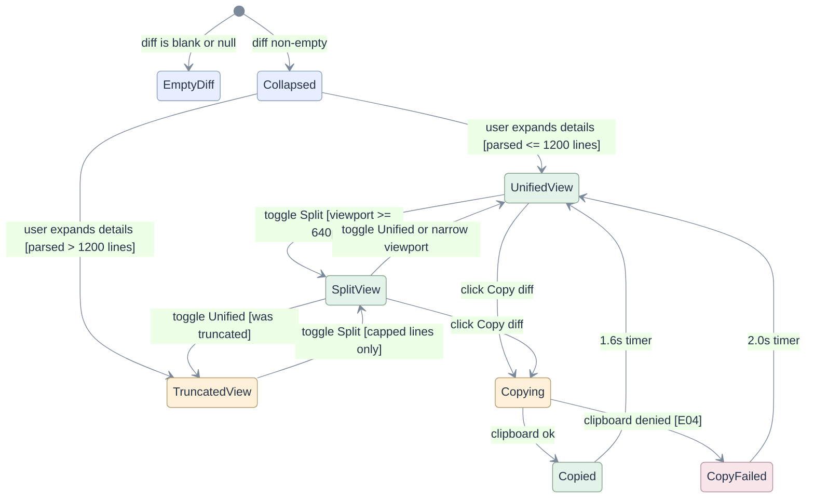
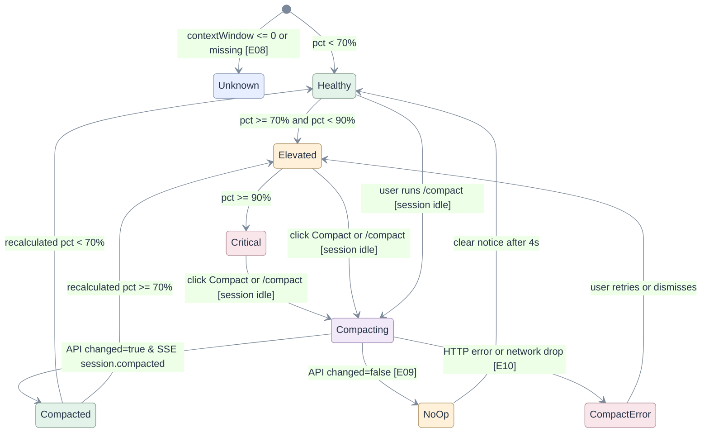
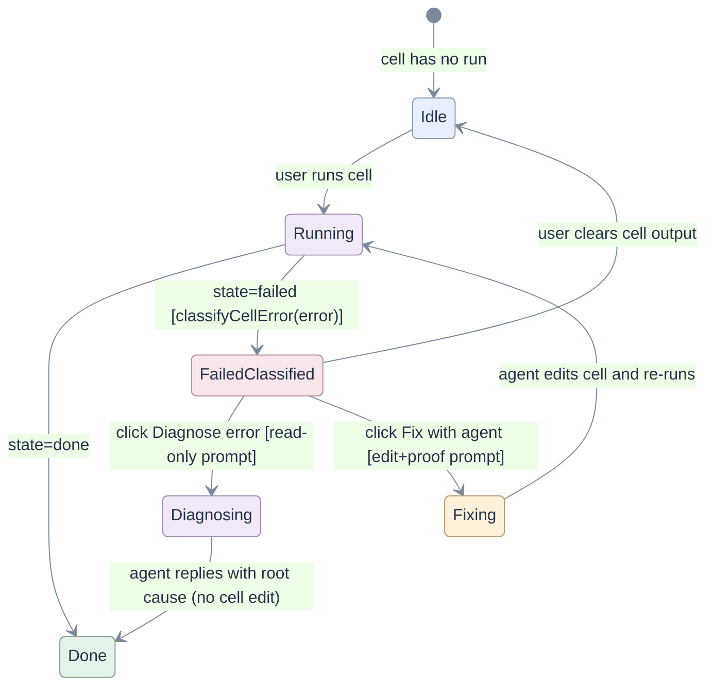
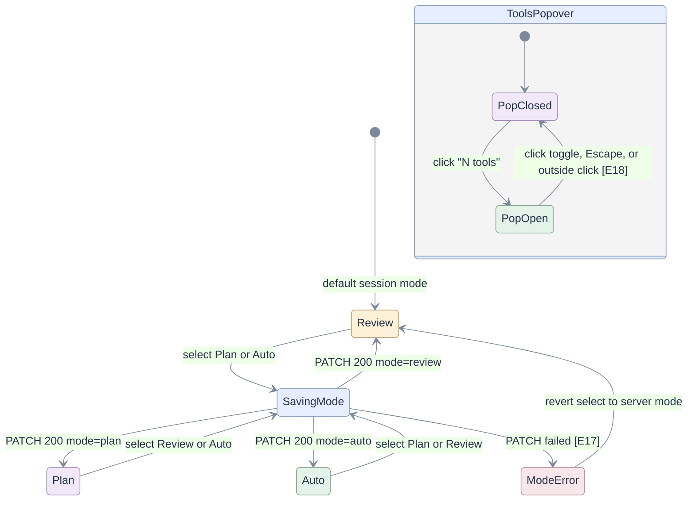
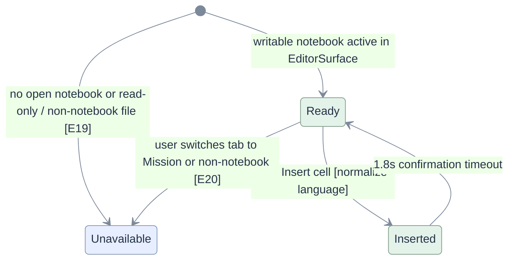

# 06 — Formal statecharts & edge-case guards

[Index](README.md) · Previous: [05 — Architecture](05-architecture.md) · Next: [07 — AI engineering](07-ai-engineering.md)

Every interactive and asynchronous lifecycle introduced or modified in `017` is modeled as an
explicit statechart so illegal transitions are unrepresentable and every edge case in
[09 — Edge-case register](09-edge-cases.md) maps to a concrete guard.

## SC-1 — Interactive diff review & decision lifecycle (`IMP-01`, `IMP-02`)

| Guard / Edge Case | Behaviour |
|---|---|
| `EmptyDiff` (`E01`) | Do not render empty diff chrome; show concise "No line diff attached" note. |
| `TruncatedView` (`E02`) | Parse and render first `1,200` lines only; show exact omitted line count; Copy still copies full diff text safely. |
| Narrow viewport (`E03`) | Split grid automatically collapses to single-column unified stack below `640px` or inside narrow docks (`overflow-x: auto` confined to diff box). |
| Clipboard denied (`E04`) | Catch rejection, show "Copy unavailable", never throw unhandled promise rejection. |
| Non-unified text (`E05`) | Lines without `@@` headers still classify `+`/`-`/context lines with sequential line numbers; zero crashes. |

## SC-2 — Context pressure & compaction lifecycle (`IMP-03`, `IMP-04`, `IMP-05`)

| Guard / Edge Case | Behaviour |
|---|---|
| Running turn (`E06`) | Compact button is disabled while `running === true`; `/compact` returns inline notice "Wait for the current turn to finish before compacting." |
| Double click (`E07`) | `Compacting` state ignores re-entrant clicks until promise settles. |
| Missing `contextWindow` (`E08`) | Meter stays `Unknown` (no `NaN%` or `Infinity%`). |
| Server `changed=false` (`E09`) | Shows honest neutral notice ("Already compact — nothing needed shedding") without faking a compaction card. |
| Duplicate SSE replay (`E11`) | `patchCompaction` upserts by `compactionId` so reconnect replay never duplicates rows. |

## SC-3 — Failed cell diagnosis vs. repair lifecycle (`IMP-08`)

| Guard / Edge Case | Behaviour |
|---|---|
| Empty error text (`E13`) | `classifyCellError("")` returns `{ kind: "runtime", label: "Execution error" }` safely; buttons still pass fallback message. |
| Huge stack trace (`E14`) | Prompt builder truncates error string to `600` chars so cell error cannot blow up token budget. |
| Read-only viewer (`E15`) | When `onFix` / `onDiagnose` are omitted (read-only view), buttons are not rendered. |

## SC-4 — Autonomy mode & tools inspector popover (`IMP-06`, `IMP-07`)

## SC-5 — Assistant code block to notebook cell insertion (`IMP-09`)

