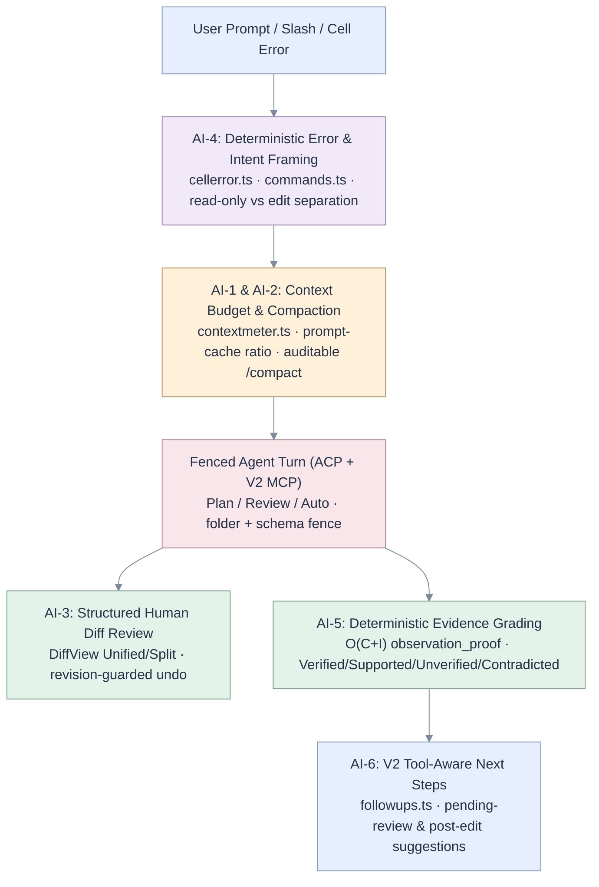

# 07 — November 2026 AI engineering blueprint

[Index](README.md) · Previous: [06 — Statecharts](06-statecharts.md) · Next: [08 — Expert lenses](08-expert-lenses.md)

By November 2026, production coding agents are judged less by raw model benchmark scores and more by
**harness engineering**: context discipline, prompt-cache efficiency, deterministic verification,
human-legible diff review, and graceful failure recovery. Spec `017` operationalizes six concrete
AI engineering principles inside OpenGenie.

## AI engineering pipeline

## Six pillars (`AI-1`–`AI-6`)

### AI-1 — Prompt-cache observability (`IMP-04`)
Modern frontier coding models deliver 50–90% lower latency and input token cost when the conversation
prefix hits the provider's prompt cache. OpenGenie already records `turn.usage.cached` and
`turn.usage.input` per turn (`SessionView`), yet never surfaced the ratio. `contextmeter.ts` sums
valid `cached` and `input` tokens across session turns and displays `XX% cached` when input > 0 and
cached > 0, giving developers immediate visibility into cache health.

### AI-2 — Auditable, objective-preserving compaction (`IMP-03`, `IMP-05`)
Silent background summarization breaks developer trust when early constraints vanish. OpenGenie's
server compaction (`api/domain/compaction.py`) preserves the opening turn (user objective) and the
most recent turns while summarizing only middle turns into a deterministic ledger of user prompts and
executed tools. Spec `017` closes the broken wire (`session_compacted` now emits a stable
`compactionId`, `status: "completed"`, and token delta, and `patchCompaction` renders it in
`AgentUpdates`) and exposes both an inline **Compact** button and `/compact` slash command.

### AI-3 — Low-friction PR-grade diff review (`IMP-01`, `IMP-02`)
Reviewing agent diffs is the human-in-the-loop reliability gate. Converting monochrome `<pre>` output
into a syntax-toned Unified/Split diff viewer with old/new line numbers and `+N/-M` statistics cuts
review time and makes off-by-one column or join errors immediately visible before clicking **Apply**.

### AI-4 — Read-only diagnosis vs. bounded mutation (`IMP-08`)
Combining error explanation with automatic code editing violates least surprise and causes unwanted
edits when a failure stems from Unity Catalog permissions or a missing upstream table. By classifying
Databricks errors deterministically (`cellerror.ts`) and separating **Diagnose error** (explicitly
forbidding edits and runs) from **Fix with agent** (bounded to that single cell + proof run), users
gain Genie Code's dual-mode debugging while retaining OpenGenie's deterministic fence.

### AI-5 — Surfaced deterministic evidence grades (`IMP-12`, `IMP-14`)
Never trust an LLM's self-reported "Done." OpenGenie grades every claim against actual tool
invocations (`verified`, `supported`, `unverified`, `contradicted`). Spec `017` accelerates server
verification to O(C + O + I) and elevates the grade badges directly onto every evidence row in both
`Transcript` and `MissionScreen`, highlighting `Contradicted` rows with their concrete reason.

### AI-6 — Tool-contract-aligned follow-ups & Databricks slash workflows (`IMP-10`, `IMP-11`)
Follow-up suggestions only help when they reflect what the agent *actually did*. Updating `followups.ts`
for the V2 facade (`dbx_edit`, `dbx_create`, `dbx_define`, `dbx_run`, `dbx_run_sql`, `dbx_operation`)
plus adding Databricks-native slash commands (`/diagnose`, `/migrate`, `/pipeline`, `/lineage`,
`/review`, `/compact`) keeps the developer in flow without boilerplate prompting.
