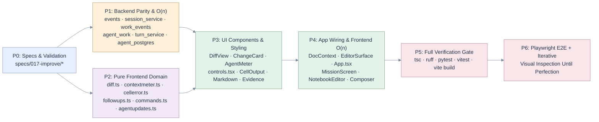

# 10 — Phased implementation plan (DRY & SOLID)

[Index](README.md) · Previous: [09 — Edge cases](09-edge-cases.md) · Next: [11 — Tests & traceability](11-tests-traceability.md)

## Delivery dependency graph

## Phase breakdown

### P0 — Specification & validation
- Write `specs/017-improve/README.md` and `01`–`11`.
- Validate cross-references, ASCII wireframe alignment, and Mermaid syntax with the repository scripts.

### P1 — Backend contract parity, concurrency & O(n) optimizations (`IMP-03`, `IMP-13`–`IMP-16`)
- `apps/coding-agent/api/domain/events.py`: enrich `session_compacted()` with `compactionId` and
  `status: "completed"` while keeping existing fields (`kept`, `summarised`, `reason`, `tokensBefore`,
  `tokensAfter`, `summary`).
- `apps/coding-agent/api/services/session_service.py`: return `compactionId` in `compact()` response
  and pass deterministic/unique ID into `session_compacted()`.
- `apps/coding-agent/api/services/work_events.py`: replace global `self._lock` with per-session
  `self._locks: dict[str, asyncio.Lock]` plus deadlock-free sorted locking when `session_id is None`.
- `apps/coding-agent/api/services/agent_work.py`: optimize `observation_proof()` to O(C + O + I) using
  a hash index of completed invocations by `(asset_kind, asset_id)`.
- `apps/coding-agent/api/services/turn_service.py`: maintain O(1) `approvals_by_call` map in
  `live.extra` for `tool_call.updated` enrichment.
- `apps/coding-agent/api/adapters/durable/agent_postgres.py`: collapse `storage()`'s 10 sequential
  queries into a single `UNION ALL` query.
- Add targeted pytest tests in `apps/coding-agent/tests/test_improve_017.py`.

### P2 — Pure frontend domain modules (`IMP-01`, `IMP-02`, `IMP-03`, `IMP-04`, `IMP-08`, `IMP-10`, `IMP-11`)
- Create `web/src/domain/diff.ts`: single-pass O(n) `parseUnifiedDiff()` + `toSplitRows()` with
  `MAX_DIFF_LINES = 1200`.
- Create `web/src/domain/contextmeter.ts`: `contextMeterState()` computing pressure tone, percent,
  cumulative prompt-cache hit-rate, and compact eligibility.
- Create `web/src/domain/cellerror.ts`: `classifyCellError()` covering Databricks SQL/Spark/UC/Python
  error classes.
- Update `web/src/domain/cellprompt.ts`: add `diagnosePrompt()` (read-only) while keeping `fixPrompt()`
  backward compatible and length-bounded.
- Update `web/src/domain/followups.ts`: add V2 tool patterns (`dbx_edit`, `dbx_create`, `dbx_define`,
  `dbx_run`, `dbx_run_sql`, `dbx_operation`) + pending/failed awareness.
- Update `web/src/domain/commands.ts`: add `/diagnose`, `/migrate`, `/pipeline`, `/lineage`,
  `/review`, `/compact` + `isCompactCommand()` helper.
- Update `web/src/domain/agentupdates.ts`: accept server compaction events (`summary: string` +
  `tokensBefore`/`tokensAfter`) while preserving strict guard for malformed events (`E12`).
- Add comprehensive Vitest unit tests (`diff.test.ts`, `contextmeter.test.ts`, `cellerror.test.ts`,
  and additions to `followups.test.ts`, `commands.test.ts`, `agentupdates.test.ts`).

### P3 — Upgraded UI components & theme-aware CSS (`IMP-01`, `IMP-04`–`IMP-09`, `IMP-12`)
- Create `web/src/components/work/DiffView.tsx`: accessible Unified/Split diff viewer with line
  numbers, `+N/-M` pills, Copy Diff, truncation banner, and full dark/light token support.
- Update `web/src/components/work/ChangeCard.tsx`: replace raw `<pre>` with `<DiffView />`.
- Update `web/src/components/work/controls.tsx`: upgrade `WorkComposerBar` with semantic mode badge,
  inline policy description, pending-review count badge, and Escape-dismissible Active Tools & Fence
  popover (preserving `aria-label="Autonomy mode"` `<select>`).
- Update `web/src/components/AgentMeter.tsx`: render pressure-colored bar, token counts, prompt-cache
  hit rate, one-click `Compact` button, and inline compaction feedback.
- Update `web/src/components/CellOutput.tsx`: display error-class badge + `Diagnose error` and
  `Fix with agent` buttons on failed cells.
- Update `web/src/components/Markdown.tsx` & `web/src/components/DocContext.ts`: add `Insert cell`
  button on code blocks when a writable notebook is open.
- Update `web/src/components/Transcript.tsx` & `web/src/components/MissionScreen.tsx`: display
  inline pastel evidence grade pills (`Verified`, `Supported`, `Unverified`, `Contradicted`) and
  contradiction reasons.
- Update `web/src/work.css` and `web/src/styles.css` with dark/light semantic tokens (eliminating
  hardcoded `#f5f4f8`/`#efedf7` surfaces).

### P4 — App wiring, frontend O(n) & hygiene (`IMP-05`, `IMP-09`, `IMP-17`, `IMP-18`)
- `web/src/components/EditorSurface.tsx`: remove `window.__m` debug leak; expose writable notebook
  `insertCell(code, lang)` handler to `DocContext`.
- `web/src/App.tsx`: wire `onCompact` (for `AgentMeter` and `/compact`), wire `InsertNotebookCell`
  context provider, and skip already-settled turns in the streaming write-sync effect.
- `web/src/components/AssistantDock.tsx` & `web/src/components/Composer.tsx`: pass compaction state
  & intercept `/compact`.
- `web/src/components/MissionScreen.tsx`: memoize turn picker options (`useMemo`).
- `web/src/components/NotebookEditor.tsx`: memoize `executionMap` (`useMemo`) and wire `onDiagnose`.

### P5 — Full verification gate
- Run `make check` (`tsc`, `ruff`, `pytest`, `vitest`) and `npm run build` in `apps/coding-agent`.

### P6 — Playwright E2E + iterative visual inspection loop
- Create `apps/coding-agent/web/scripts/improve-017-e2e.mjs` running against real local FastAPI +
  SQLite + built React bundle.
- Capture screenshots across all key states (desktop light, desktop dark, split diff, tools popover,
  compaction roundtrip, failed cell diagnose/fix, insert cell into notebook, evidence grades, narrow
  390px mobile) into `specs/017-improve/e2e/screenshots/`.
- Visually inspect every single screenshot via image Read, record defects/polish opportunities, apply
  CSS/layout refinements, rebuild, re-run E2E, and re-inspect until every screenshot is crisp and
  balanced.
