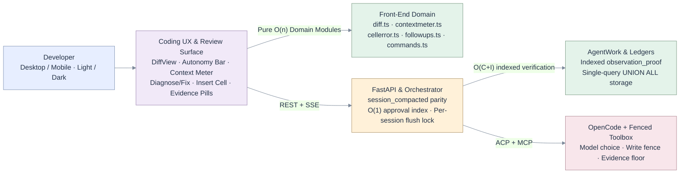

# 017 — Surpassing Databricks Genie Code: November 2026 Coding Agent Assessment & Improvement Suite

Status: **specified, implemented, and E2E visually verified** (baseline commit `054b5aa`, 21 November 2026).

OpenGenie already holds three structural advantages over Databricks Genie Code: **model choice**
(any serving endpoint, AI Gateway/XAIA, OpenAI, Anthropic, Vertex), **server-enforced write fences**
(folder, schema, job prefix), and **evidence-verified completion** (*"done means proven"*). This
specification audits the live codebase against Databricks Genie Code and November 2026 AI
engineering best practices, identifies 16 concrete code-grounded defects and experience gaps
([C01–C16](02-code-grounding.md#findings)), and delivers a cohesive, DRY/SOLID upgrade across
backend concurrency, database queries, agent context engineering, diff review, cell diagnostics,
code-to-notebook workflows, and visual polish.

## Reading order

Start with [01 — Five whys and first principles](01-five-whys.md). Every identifier is defined once
and cross-referenced across the suite:

| Document | Purpose | Key identifiers |
|---|---|---|
| [01 — Five whys & first principles](01-five-whys.md) | Root-cause decomposition, invariants, Genie Code benchmark | `FP-1`–`FP-8` |
| [02 — Code grounding](02-code-grounding.md) | File-and-line audit of the current implementation (`054b5aa`) | `C01`–`C16` |
| [03 — Requirements](03-requirements.md) | Normative P0/P1 requirements and measurable acceptance gates | `IMP-01`–`IMP-18` |
| [04 — UX & ASCII wireframes](04-ux-wireframes.md) | Desktop, dock, narrow/mobile, and dark-mode ASCII wireframes | `W01`–`W07` |
| [05 — Architecture & data model](05-architecture.md) | SOLID/DRY boundaries, ER model, pastel Mermaid sequence flows | `SEQ-1`–`SEQ-4` |
| [06 — Statecharts](06-statecharts.md) | Formal transition machines and guard tables for edge-case safety | `SC-1`–`SC-5` |
| [07 — AI engineering (Nov 2026)](07-ai-engineering.md) | Context budgets, prompt-cache observability, compaction, grounding | `AI-1`–`AI-6` |
| [08 — Expert lenses & O(n) analysis](08-expert-lenses.md) | Seven specialist lenses + Big-O complexity budget table | `L1`–`L7`, `O1`–`O8` |
| [09 — Edge-case register](09-edge-cases.md) | 32 failure modes mapped to statechart guards, mitigations, and tests | `E01`–`E32` |
| [10 — Implementation plan](10-implementation-plan.md) | Phased DRY/SOLID delivery order, file targets, rollback gates | `P0`–`P6` |
| [11 — Tests & traceability](11-tests-traceability.md) | Requirement/risk-to-test matrix, Playwright E2E, visual review log | `T01`–`T16` |

## System improvement map

## Competitive positioning vs. Databricks Genie Code (November 2026)

| Capability | Databricks Genie Code (Nov 2026) | OpenGenie Before `017` | OpenGenie After `017` |
|---|---|---|---|
| Model selection & cost control | Fixed platform model; metered billing | 18+ models across 5 providers + XAIA Gateway | Same + prompt-cache hit-rate & actionable context meter ([IMP-04](03-requirements.md#requirements)) |
| Write safety & approval | Heuristic AI classifier (non-security boundary) | Deterministic server fence + Review/Auto/Plan | Same + policy-labeled autonomy bar & live tool inspector ([IMP-06](03-requirements.md#requirements)) |
| Diff review UX | Inline accept/reject diff | Flat monochrome `<pre>` text dump ([C01](02-code-grounding.md#c01)) | Syntax-toned Unified/Split diff viewer, line numbers, `+N/-M` stats, copy ([IMP-01](03-requirements.md#requirements)) |
| Failed cell workflow | Diagnose Error + Quick Fix | Single "Fix with agent" button ([C06](02-code-grounding.md#c06)) | Error-class badge + separate **Diagnose error** (read-only) & **Fix with agent** ([IMP-08](03-requirements.md#requirements)) |
| Chat-to-notebook bridge | Copy or apply snippet | SQL-only "Open as query" ([C07](02-code-grounding.md#c07)) | One-click **Insert cell** into active notebook + SQL **Open as query** ([IMP-09](03-requirements.md#requirements)) |
| Context compaction | Automatic opaque summarization | Broken wire: client dropped `session.compacted` ([C02](02-code-grounding.md#c02)) | End-to-end auditable compaction via meter button & `/compact` ([IMP-03](03-requirements.md#requirements), [IMP-05](03-requirements.md#requirements)) |
| Post-turn follow-ups | Static/contextual prompts | Broken for V2 tools (`dbx_edit`/`dbx_run`) ([C05](02-code-grounding.md#c05)) | V1+V2 tool-aware follow-ups + pending-review awareness ([IMP-10](03-requirements.md#requirements)) |
| Slash workflows | Built-in `/fix`, `/explain`, `/doc`, `/optimize` | 12 templates, missing Lakeflow/migrate/lineage/compact | 18 Databricks-native templates including `/diagnose`, `/migrate`, `/pipeline`, `/lineage`, `/review`, `/compact` ([IMP-11](03-requirements.md#requirements)) |
| Proof of completion | Self-reported prose | Server-verified evidence, grades hidden in details ([C09](02-code-grounding.md#c09)) | Scannable pastel grade pills (`Verified`, `Supported`, `Unverified`, `Contradicted`) ([IMP-12](03-requirements.md#requirements)) |

## Diagram convention

- **Screen & navigation wireframes** use printable fixed-width ASCII boxes ([04](04-ux-wireframes.md)).
- **Architecture, ER, sequence, and state diagrams** use Mermaid with a consistent pastel palette
  (blue `#E7EEFF`, mint `#E4F3EA`, lavender `#F1E9F8`, amber `#FFF1D9`, rose `#F8E6EB`) and dark
  ink (`#243247`) for accessible contrast. Color supplements text labels and never carries meaning alone.
