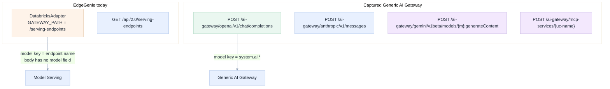

# 02 — Code grounding

[Index](README.md) · prev: [01 Five whys](01-five-whys.md) · next: [03 Protocol](03-protocol.md)

Two bodies of code were read. They are not the same gateway.

| Body | What it is | Use it for |
|---|---|---|
| This OpenGenie repository | Model Serving at `/serving-endpoints`, and a measured Databricks door at `/ai-gateway/...` | Do not retarget the serving adapter. Citations below |
| Client tree of 17 Nov 2026, `src/agents/llm_client.py` and `src/agents/provider_routing.py` | Azure API Management, header `api-key`, Azure OpenAI deployment URLs | The provider to implement. Normative wire: [12](12-client-wire.md) |

The sections below are the OpenGenie repository only. The known provider of the
client gateway is stated in [12](12-client-wire.md#known-provider).

## Known provider of the doors in this repository

| Label | Meaning |
|---|---|
| C | Behavior implemented in application or experiment code |
| M | A captured outcome recorded in this repository |
| D | A string the repository cites as documentation, without a response body |
| U | Not captured. The specification must not invent it |

## Known provider

Three layers, kept apart because this repository uses "gateway" for more than one of them.

| Layer | What it is | Evidence |
|---|---|---|
| Operator of Door G | **Databricks** | Host `*.cloud.databricks.com`, credential `DATABRICKS_TOKEN`, OAuth scope `ai-gateway`, experiments calling the same paths "Unity Gateway" |
| Chat wire of Door G | **OpenAI Chat Completions**, package `@ai-sdk/openai-compatible` | `templates/opencode.gpt-oss.json` base URL `/ai-gateway/openai/v1` |
| What the shipping catalogue calls a gateway | **Databricks Model Serving**, not Door G | Seed display name "Databricks AI Gateway", adapter path `/serving-endpoints`, picker tag for provider `databricks` is the word `gateway` (`web/src/domain/models.ts`) |

No other operator is named on these paths. The Go sentence `json: unknown field` identifies the decoder on Door G. It is not a second provider.

Sibling wires on the same operator, captured and not the default: Anthropic Messages at `/ai-gateway/anthropic/v1`, Gemini `generateContent` at `/ai-gateway/gemini/v1beta`, MCP JSON-RPC at `/ai-gateway/mcp-services/`. Those are doors. They are not other companies.

## Who operates it

The Generic AI Gateway in this specification is the front door whose paths start
with `/ai-gateway/`. The operator is Databricks. That is an identification from
this repository, not a brand preference.

| Evidence | Where | Label |
|---|---|---|
| Workspace host `https://dbc-cb61f1e1-bd8e.cloud.databricks.com` used as the default for the MCP client | `experiments/dbx_mcp.py` | C |
| Credential variable `DATABRICKS_TOKEN`, sent as `Authorization: Bearer` | `experiments/dbx_mcp.py`, `experiments/copilot_field_shim.py`, `templates/opencode.gpt-oss.json` | C |
| OAuth scope literal `ai-gateway` requested by the app | `databricks.yml` user_api_scopes | C |
| Display string "Databricks AI Gateway" on the provider the seed ships | `apps/coding-agent/seed/llm_models.yaml` | C |
| Same display string written by discovery onto every serving endpoint | `apps/coding-agent/api/adapters/llm/discovery/databricks.py` | C |
| Experiments label the `/ai-gateway/` paths "Unity Gateway" | `experiments/dbx_mcp.py` module doc, `docs/genie-code-replacement-spec.md` §3 | M |
| Rejection `json: unknown field "__copilotMessageSource"` | `experiments/copilot_field_shim.py` | M |

The `json: unknown field` sentence is the error text of Go's `encoding/json`
decoder when unknown fields are rejected. It identifies the decoder on that
front door. It does not identify a second company. The host, the token, and the
scope identify the operator.

No source file in this repository uses any other product name for these paths.
The specification therefore does not import one.

## Two doors

### Door S — what the shipping provider calls

Implemented in `apps/coding-agent/api/adapters/llm/providers/databricks.py`.

| Item | Value | Label |
|---|---|---|
| Base | `{normalize_host(host)}/serving-endpoints` | C |
| Probe | `POST {base}/{model_key}/chat/completions` | C |
| Probe body | `{"messages":[{"role":"user","content":"ok"}],"max_tokens":1}` | C |
| Auth header | `Authorization: Bearer <secret>` | C |
| npm | `@ai-sdk/openai-compatible` | C |
| Agent block | `dbx` | C |
| Model key | Serving endpoint name, for example `databricks-llama-4-maverick` | C |
| Discovery | `GET /api/2.0/serving-endpoints`, chat task, `state.ready == READY`, cache 300s, denial not cached | C |
| Empty host | The path only: `/serving-endpoints` | C |

`normalize_host` (`apps/coding-agent/api/domain/urls.py`) strips the value, removes
a trailing slash, and prefixes `https://` when no scheme is present.

The golden file `apps/coding-agent/tests/fixtures/opencode.databricks.golden.json`
records `baseURL` `https://h.example.com/serving-endpoints` and model
`dbx/databricks-llama-4-maverick`. Vision for llama was measured with
`POST /serving-endpoints/databricks-llama-4-maverick/invocations` and an
`image_url` block (`apps/coding-agent/seed/llm_models.yaml`). That is Door S.
It is not a capture of Door G.

### Door G — what the captures call

| Door | Path | Label |
|---|---|---|
| OpenAI chat | `/ai-gateway/openai/v1/chat/completions` | M, `docs/genie-code-replacement-spec.md` §3.1 and §7.2 |
| Anthropic messages | `/ai-gateway/anthropic/v1/messages` | M as a refusal; the success path is gated |
| Gemini native | `/ai-gateway/gemini/v1beta/models/{m}:generateContent` | M as a refusal; body of a success is U |
| MCP | `/ai-gateway/mcp-services/<uc-name>` | M, tool list in `docs/e2e/mcp_tools.txt` |
| Skills | `/ai-gateway/skills/` | D, "per docs" in the same matrix. No request body in this repository |

The working OpenAI configuration is `templates/opencode.gpt-oss.json`:

- npm `@ai-sdk/openai-compatible`
- `baseURL` `https://YOUR-WORKSPACE.cloud.databricks.com/ai-gateway/openai/v1`
- `apiKey` `{env:DATABRICKS_TOKEN}`
- model key `system.ai.gpt-oss-120b`
- agent model ref `dbx/system.ai.gpt-oss-120b` in that template

The template reuses the block name `dbx`. This specification does not. Reusing
it would put a gateway model and a serving model in one agent block and make
the golden file ambiguous. See [04](04-provider-contract.md#agent-file).

`experiments/copilot_field_shim.py` forwards to `UPSTREAM_BASE` ending in
`/ai-gateway/openai/v1`, passes `Authorization`, `Content-Type: application/json`,
and the caller's `Accept`, and deletes every object key that starts with
`__copilot` at any depth before the forward. Other unknown keys are left in
place, which is how the door's strict decoder was observed.

### Alias table, and why it decides the id prefix

`ALIASES` in `apps/coding-agent/api/domain/llm/model.py` maps, among others:

| Stored id | Canonical id |
|---|---|
| `databricks/system.ai.gpt-oss-120b` | `databricks/databricks-gpt-oss-120b` |
| `databricks/system.ai.qwen3-next-80b-a3b-instruct` | `databricks/databricks-qwen3-next-80b-a3b-instruct` |
| `databricks/system.ai.claude-sonnet-4-5` | `databricks/databricks-claude-sonnet-4-5` |
| `dbx/databricks-llama-4-maverick` | `databricks/databricks-llama-4-maverick` |

`ModelId.parse` lowercases, applies that table, then splits on the first slash.
The comment above the table states the reason: the gateway advertises a
foundation-model name and the serving agent needs the endpoint name. That
rewrite stays. Gateway catalogue ids therefore cannot use the `databricks/`
prefix. [05](05-data-model.md#identity) defines `gateway/` instead.

## Caps that were named by an error

From `docs/genie-code-replacement-spec.md` §3.2, on the gateway model ids:

| Model id sent | Phrase | Named ceiling |
|---|---|---|
| `system.ai.gpt-oss-120b` | `max_new_tokens 32000 cannot be greater than max_output_tokens 25000` | 25000 |
| `system.ai.qwen3-next-80b-a3b-instruct` | `max_tokens (24000) cannot exceed 10000` | 10000 |
| `system.ai.llama-4-maverick` | `max_tokens (24000) cannot exceed 8192` | 8192 |
| `system.ai.gpt-oss-20b` | no ceiling in the table | U |
| `system.ai.claude-*`, `system.ai.gemini-*` | `MODEL is not enabled` (`INVALID_STATE`) | not a cap |

The serving seed (`llm_models.yaml`) stores different numbers for the *serving*
endpoints: gpt-oss output 24000, llama output 8000. Those rows are Door S.
Copying them onto Door G would send a number the gateway measurement does not
support, or would claim a measurement that was made on another path.
`cap_from_error` in `limits.py` already parses all three phrase shapes and is
specified to lower a stored cap only.

Context length `128000` appears in the template and in the serving seed. It does
not appear in the §3.2 table. For Door G it is documented by the template, not
measured by an error. [05](05-data-model.md#seed-rows) records it that way.

## Refusals that were captured

| Phrase | Where it was seen | What a person can do |
|---|---|---|
| `MODEL is not enabled` / `INVALID_STATE` | partner models, §4.6 | An account admin enables the model. The user cannot. |
| `PERMISSION_DENIED` plus `is no longer available. Use Unity Catalog model services.` | Anthropic door, old endpoint name `databricks-claude-sonnet-4-6` | Send the UC name on the UC door. This is not a bad token. |
| `ENDPOINT_NOT_FOUND` | OpenAI door, `system.ai.claude-sonnet-4-6` | That name is not on that door. |
| `json: unknown field "__copilotMessageSource"` | OpenAI door via Copilot CLI | Remove that key before sending. The first call can succeed and the post-tool call dies. |
| `Function call is missing a thought_signature` | Gemini 3.x through an OpenAI-compatible client, §4.7 | Echo `extra_content.google.thought_signature`. A client that drops unknown fields cannot. |
| `401` / `403`, missing scope text | `DbxHttp.denial` | Scope missing is an app setting (`ScopeMissing`). An ACL denial is the caller's grant. |

`classify` in `apps/coding-agent/api/domain/llm/errors.py` does **not** mention
`unknown field`, `ENDPOINT_NOT_FOUND`, or `no longer available`. Today:

- `INVALID_STATE` and `MODEL is not enabled` become `not_enabled`.
- `permission denied` becomes `unauthorised`, and the pattern is case-insensitive,
  so the Anthropic `PERMISSION_DENIED … no longer available` sentence becomes
  **unauthorised** before anyone reads the rest. That is the wrong action.
- `ENDPOINT_NOT_FOUND` matches nothing and stays `unknown`.
- `unknown field` stays `unknown`.

[03](03-protocol.md#refusals) adds phrases. It does not retune the rules that
existing serving fixtures already lock. The new phrases are more specific and
are tested to win only on those sentences ([09](09-edge-cases.md) E-08, E-09).

## MCP, as the client in this repository speaks it

`experiments/dbx_mcp.py` and `notebooks/launch_agent_from_notebook.py`:

- `POST {host}{endpoint}`
- Body `{"jsonrpc":"2.0","id":1,"method":...,"params":...}`
- Headers `Authorization: Bearer`, `Content-Type: application/json`,
  `Accept: application/json, text/event-stream`
- If the body contains a line starting with `data: `, that line's remainder is
  the JSON payload. The client uses the last such line it sees.
- Methods that succeeded in captures: `tools/list` with `{}`, and `tools/call`
  with `{"name","arguments"}`.
- The client does not send `initialize`. The list calls still returned tools.
  A requirement to initialize is U.

Captured tool names (`docs/e2e/mcp_tools.txt`, 2026-11-06, PAT):

| Service | Tools |
|---|---|
| `/ai-gateway/mcp-services/system.ai.dbsql` | `execute_sql`, `poll_sql_result` |
| `/ai-gateway/mcp-services/system.ai.sandbox` | `create_sandbox`, `run_code`, `delete_sandbox` |
| `/ai-gateway/mcp-services/system.ai.web_search` | `web_search` |
| `/ai-gateway/mcp-services/system.ai.genie_one_mcp` | `genie_ask`, `genie_poll_response`, `genie_get_query_result`, `genie_cancel_response` |

The workspace path `/api/2.0/mcp/sql` is a different server. It listed three SQL
tools, including `execute_sql_read_only`. A gateway client must not call that
path and report it as the gateway.

## What the app does not do

| Gap | Label |
|---|---|
| No application module builds a URL under `/ai-gateway/` | C, search of `apps/coding-agent` |
| The scope `ai-gateway` is requested and never used by `DatabricksAdapter` | C |
| No capture of a gateway chat response schema (tool-call JSON, usage, stream frames) lives in `docs/e2e/` as raw HTTP | U. The replacement spec says a two-turn tool round-trip succeeded streamed and not streamed. The frame bytes are not in the application. |
| No capture that the OpenAI door accepts images | U. Vision flags on serving rows must not be copied. |
| No capture of `/ai-gateway/skills/` request or response | U |
| Gemini native success body, and whether `thought_signature` survives that door | U. The OpenAI-compatible failure is M. The native sandbox attempt returned Not Found and is recorded as unresolved. |

Those unknowns are requirements to refuse or to omit, not backlog items to guess.
See [04](04-provider-contract.md#non-goals) and [09](09-edge-cases.md).
