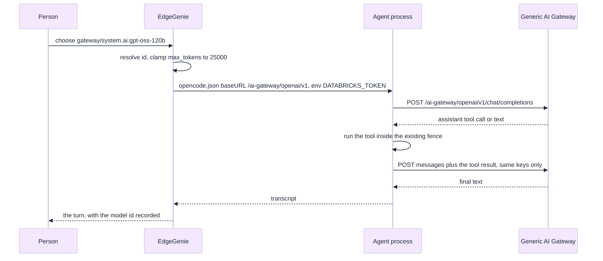

# 03 — Protocol of the Databricks door

[Index](README.md) · prev: [02 Code grounding](02-code-grounding.md) · next: [04 Provider contract](04-provider-contract.md)

**Background. Do not implement this document.** It records the Databricks
front door measured inside the OpenGenie repository (`/ai-gateway/...`, bearer
token, `system.ai.*` model names). The provider to build speaks a different
URL and a different header. That wire is [12](12-client-wire.md).

The paths below are still the law for anyone reading the OpenGenie captures.
A client that adds a field this door did not accept is not compatible with
**this** door. The measured door rejects unknown JSON keys.

Labels C, M, D, and U are defined in [02](02-code-grounding.md).

## Doors

Host grammar is `normalize_host` ([02](02-code-grounding.md#door-s--what-the-shipping-provider-calls)).
Every path below is appended to that host with a single slash. A base URL that
does not start with `https://` after normalisation is a configuration error and
is not sent. The provider table already rejects a stored `http://` base
(`001_llm_schema.sql`, `provider_https`).

| Door id | Method and path | Model key | Credential |
|---|---|---|---|
| `gateway_openai` | `POST /ai-gateway/openai/v1/chat/completions` | `system.ai.<name>` in the JSON `model` field | Bearer workspace token |
| `gateway_anthropic` | `POST /ai-gateway/anthropic/v1/messages` | `system.ai.<name>` in the JSON `model` field | Bearer workspace token, and the same value where the Anthropic client sends `x-api-key` |
| `gateway_gemini` | `POST /ai-gateway/gemini/v1beta/models/{model}:generateContent` | the `{model}` path segment, UC name | Bearer workspace token |
| `gateway_mcp` | `POST /ai-gateway/mcp-services/{uc-name}` | none; the UC name is the service | Bearer workspace token |

`{uc-name}` values captured: `system.ai.dbsql`, `system.ai.sandbox`,
`system.ai.web_search`, `system.ai.genie_one_mcp`.

Skills (`/ai-gateway/skills/`) are D. They are not a door of this provider until
a request and a response are captured.

## OpenAI chat

This is the only model door with a captured success
(`docs/genie-code-replacement-spec.md` §3.1, §4.1, §4.10, §7.2,
`templates/opencode.gpt-oss.json`).

### Probe, which is also the minimal successful shape

```http
POST /ai-gateway/openai/v1/chat/completions HTTP/1.1
Authorization: Bearer <workspace token>
Content-Type: application/json
Accept: application/json

{"model":"system.ai.gpt-oss-120b","messages":[{"role":"user","content":"ok"}],"max_tokens":1}
```

| Rule | Source |
|---|---|
| `model` is the UC name, not a serving endpoint name and not `dbx/...` | template model key; alias table would rewrite the other forms |
| `messages` is an array of `{role, content}` for the probe | same shape as `OpenAIAdapter.probe`, which is the OpenAI-compatible probe in this repo |
| `max_tokens` is a positive integer no greater than the stored output cap | §3.2 errors; `limits.clamp` |
| No `stream` key on the probe | the probe must be one JSON object, classifiable without an SSE parser |
| No key starting with `__copilot` at any depth | `copilot_field_shim.py` |
| No other key unless a later capture shows that exact key accepted | P5 |

The application does not itself post this body today. The body is the OpenAI
Chat Completions shape selected by `@ai-sdk/openai-compatible` plus the probe
this repository already uses for that npm package, with `model` taken from the
template. Implementing a different body is a new protocol and needs a new capture.

### Agent configuration the npm client consumes

The child does the multi-turn call. EdgeGenie writes the file; it does not
reimplement chat. The file shape, adapted from the template and from
`ProviderBlock.as_dict`:

```json
{
  "npm": "@ai-sdk/openai-compatible",
  "name": "Generic AI Gateway",
  "options": {
    "baseURL": "https://<workspace>/ai-gateway/openai/v1",
    "apiKey": "{env:DATABRICKS_TOKEN}"
  },
  "models": {
    "system.ai.gpt-oss-120b": {
      "name": "gpt-oss-120b",
      "limit": { "context": 128000, "output": 25000 }
    }
  }
}
```

`limit.output` is `25000` here because that is the ceiling the gateway named for
this id. The template's `24000` is the serving seed's number and is not copied
([02](02-code-grounding.md#caps-that-were-named-by-an-error)).

`attachment` and `modalities` are omitted. They are how Door S asks the agent to
send an image. Door G has no image capture, and declaring vision would make the
client send `image_url` ([E-14](09-edge-cases.md#register)).

The block name in the agent file is `gateway`, so the selected model is
`gateway/system.ai.gpt-oss-120b`. The template used `dbx`. That reuse is rejected
in [04](04-provider-contract.md#agent-file).

### Streaming

The measurement log says a synthetic two-turn tool round-trip succeeded both
streamed and not streamed. The SSE byte layout is U. The provider therefore:

- does not set a stream flag in the probe;
- does not disable streaming in the agent file for this door;
- does not parse model SSE in the app. The npm client does.

A stall after many tool calls, with HTTP 200, was reproduced and explicitly
called not a gateway defect (§4.10). The provider does not retry a completed
turn. The product's existing stall handling stays where it is.

### Caps to send

| `model` | `max_tokens` the client may send | Evidence |
|---|---|---|
| `system.ai.gpt-oss-120b` | at most 25000 | M, `max_output_tokens 25000` |
| `system.ai.qwen3-next-80b-a3b-instruct` | at most 10000 | M |
| `system.ai.llama-4-maverick` | at most 8192 | M |
| `system.ai.gpt-oss-20b` | 4000 until a capture names a ceiling | U, so `LimitEvidence.DEFAULT` |
| any other name | 4000, context 64000 | `DEFAULT_LIMITS` |

"Cannot exceed" was observed when the sent value was greater than the ceiling.
Sending a value equal to the ceiling is not separately captured. The client
sends the stored ceiling. If the door rejects equality, the error names a number
and `cap_from_error` stores the lower one ([E-04](09-edge-cases.md#register)).

Context `128000` is stored with evidence `documented` and source
`templates/opencode.gpt-oss.json`. It is not marked measured.

## Anthropic messages

Captured as a refusal, and as a configuration Databricks' own agent file uses
once the model is enabled (`docs/genie-code-replacement-spec.md` §7.2).

```json
{
  "npm": "@ai-sdk/anthropic",
  "options": {
    "baseURL": "https://<workspace>/ai-gateway/anthropic/v1",
    "apiKey": "{env:DATABRICKS_TOKEN}",
    "headers": { "Authorization": "Bearer {env:DATABRICKS_TOKEN}" }
  },
  "models": {
    "system.ai.claude-sonnet-4-5": { "options": { "toolStreaming": false } }
  }
}
```

| Rule | Why |
|---|---|
| `apiKey` and `Authorization` are the same workspace token | the captured config sets both. The npm package sends the key as `x-api-key`. |
| `anthropic-version: 2023-06-01` is sent by `AnthropicAdapter` | C for that adapter. It is a header, so the JSON unknown-field rule does not apply. A body field of that name is not added. |
| `toolStreaming: false` | the captured config. With it on, tool calls arrive in a shape this agent's mapper does not reassemble. The flag is per model. |
| The model is not selectable while the probe returns `MODEL is not enabled` or `ENDPOINT_NOT_FOUND` | §4.6. The row exists so the picker can name the admin action. |

The probe body is the one `AnthropicAdapter.probe` already sends, with the UC
name as `model` and `max_tokens` 1:

```json
{"model":"system.ai.claude-sonnet-4-5","max_tokens":1,"messages":[{"role":"user","content":"ok"}]}
```

No success body was captured. The provider classifies the refusal and stops.
It does not retry on the OpenAI door with a translated name.

## Gemini native

Path: `POST /ai-gateway/gemini/v1beta/models/{model}:generateContent`.

The success body is U. Partner models returned `MODEL is not enabled`. A native
adapter attempt in the sandbox returned Not Found and is unresolved (§4.7).
Gemini 3.x tool calls require `extra_content.google.thought_signature` on the
next turn when the call was produced by that model. An OpenAI-compatible client
drops that field and the second turn is HTTP 400.

Consequences, until a capture exists:

- The door is catalogued and not selectable for a session that must call tools.
- The provider does not point `@ai-sdk/openai-compatible` at this path.
- The provider does not advertise `sees_images`.
- A `thought_signature` error is `protocol_error` / `degraded`, which `classify`
  already does. The copy tells the user this door cannot complete a tool loop
  in the current client ([07](07-ux-wireframes.md#copy)).

## MCP

Normative client, taken from `experiments/dbx_mcp.py`. This is a separate port
([04](04-provider-contract.md#ports)).

```http
POST /ai-gateway/mcp-services/system.ai.dbsql HTTP/1.1
Authorization: Bearer <workspace token>
Content-Type: application/json
Accept: application/json, text/event-stream

{"jsonrpc":"2.0","id":1,"method":"tools/list","params":{}}
```

Call:

```json
{"jsonrpc":"2.0","id":1,"method":"tools/call","params":{"name":"execute_sql","arguments":{}}}
```

Response handling:

1. Read the body as text.
2. If any line starts with `data: `, replace the payload with the remainder of
   the last such line.
3. Parse one JSON object.
4. `result.isError == true` is a tool failure, not a transport failure.
5. Text results are the `text` of each item in `result.content`.

`initialize` is not sent. It was not required for the captured lists. Adding it
is a behavior change and needs a capture that shows a server refusing the list
without it.

Timeout on the experiment client is 300 seconds. The app's workspace HTTP client
uses 20 seconds (`DbxHttp.TIMEOUT`). A gateway MCP call uses the experiment's
budget only for `tools/call` that the service itself documents as long (SQL,
sandbox, Genie poll). `tools/list` uses 20 seconds. A hung call is a timeout,
retryable once, then `degraded`. It is not retried in a loop.

The SQL service on this door listed two tools. The workspace MCP path listed
three. Clients must not fall back from one URL to the other.

## Refusals

Order is the specification. The first match wins. Phrases already in `_RULES`
keep their meaning for sentences that do not contain a more specific phrase
added here. Existing fixtures in `tests/test_llm_domain.py` must stay green
without editing their expected cause.

| Order | Substring, case-insensitive | Cause | State | Retry |
|---|---|---|---|---|
| 1 | `cannot exceed` or `cannot be greater than max_output_tokens` | `cap_exceeded` | `degraded` | no |
| 2 | `thought_signature` | `protocol_error` | `degraded` | no |
| 3 | `json: unknown field` | `protocol_error` | `degraded` | no |
| 4 | `no longer available` or `use unity catalog model services` or `ENDPOINT_NOT_FOUND` | `not_found` | `not_served` | no |
| 5 | `MODEL is not enabled` | `not_enabled` | `not_enabled` | no |
| 6 | existing `INVALID_STATE` rule | `not_enabled` | `not_enabled` | no |
| 7 | existing unauthorised rule (`401`, `403`, `permission denied`, …) | `unauthorised` | `unauthorised` | no |
| 8 | `429`, `rate limit`, `too many requests`, `quota exceeded` | `rate_limited` | `degraded` | yes, once |
| 9 | existing not-found phrases (`404`, `does not exist`, `model not found`) | `not_found` | `degraded` | no |
| 10 | timeout phrases | `timeout` | `degraded` | yes, once |

Rule 4 is placed before rule 7 because the captured Anthropic sentence contains
`PERMISSION_DENIED` and `no longer available` together. Rule 7 would otherwise
tell the user their token is bad.

Rule 3 does not trigger a strip-and-retry. The `__copilot` strip happens before
the first send. A 400 that still names an unknown field is a bug in the client
we shipped. Retrying would hide it.

`useful_text` already prefers a JSON `"message"` or `"error"` string, truncated
to 400 characters, then `redact`. Gateway details go through that function.
They are stored in `llm_health.detail`, which rejects a value longer than 400.

HTTP status from the probe, before the phrase table, matches `BaseAdapter`:

| Status | State |
|---|---|
| 2xx | `available`, empty detail |
| 401 or 403 | `unauthorised`, unless the body matches rule 4 or rule 5 first |
| other | the phrase table; if nothing matches, `unknown` |

`unknown` is not `degraded`. `classify` already implements that default, and the
gateway provider keeps it. A 401 whose body is the "no longer available"
sentence follows rule 4, not the status shortcut. The probe must pass the body
through the phrase table before the status shortcut. That is a one-line change
in the gateway probe only. `BaseAdapter._post` is not rewritten, because serving
probes depend on its current order ([E-08](09-edge-cases.md#register)).

## Sequence: one compatible chat



The tool the child runs is the app's fenced tool server, unless the session
also configured the MCP port. The model door does not become a tool door in
this sequence.
