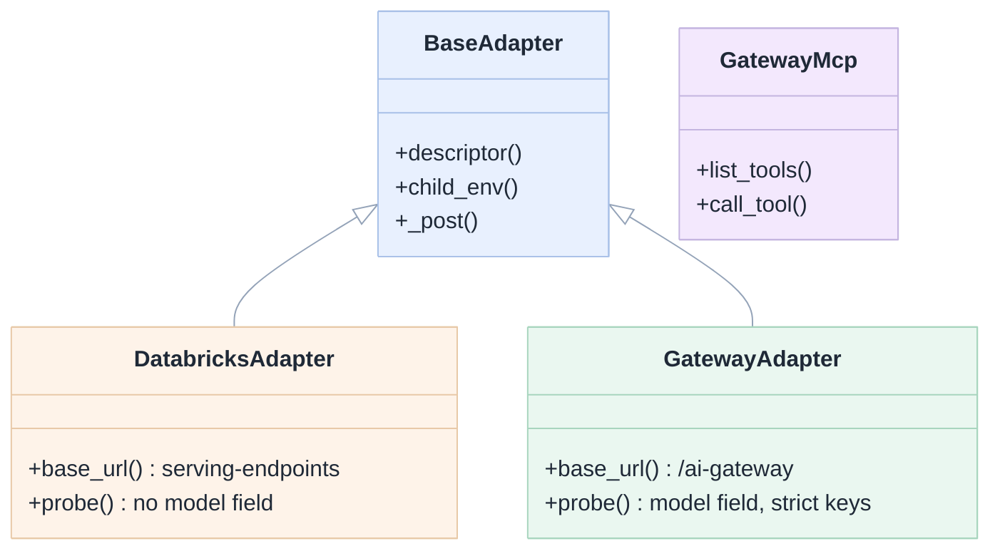

# 04 — Contract for the Databricks door

[Index](README.md) · prev: [03 Protocol](03-protocol.md) · next: [05 Data model](05-data-model.md)

**Background, except GW-11.** GW-11 is in force: do not change
`DatabricksAdapter` or `opencode.databricks.golden.json`. The other rows in
the table below describe a Databricks bearer provider. They are not the client
in [12](12-client-wire.md). The index lists which rows contradict that client.

## Two Databricks providers

| | Serving provider, unchanged | Databricks `/ai-gateway` door, not the build |
|---|---|---|
| Kind | `ProviderKind.DATABRICKS` (`databricks`) | new `ProviderKind.GATEWAY` (`gateway`) |
| Module | `adapters/llm/providers/databricks.py` | new `adapters/llm/providers/gateway.py` |
| Wires | `serving` | `gateway_openai`, `gateway_anthropic`, `gateway_gemini` |
| Base | `{host}/serving-endpoints` | `{host}/ai-gateway/<door>` |
| Model key | endpoint name | `system.ai.<name>` |
| Agent block | `dbx` | `gateway` |
| Discovery | `GET /api/2.0/serving-endpoints` | none until a list URL is captured |
| Golden file | `opencode.databricks.golden.json` | new `opencode.gateway.golden.json` |
| Credential | `DATABRICKS_TOKEN` | the same variable, a different door |

`agent_prefix` returns `gateway` for `ProviderKind.GATEWAY`. It does not return
`dbx`. `FAKE` stays on `dbx` so demo mode does not change.

## Requirements

| Id | Statement | Principle |
|---|---|---|
| GW-01 | A resolved gateway model has `base_url` ending in `/ai-gateway/openai/v1`, `/ai-gateway/anthropic/v1`, or `/ai-gateway/gemini/v1beta`, and nothing else. | P1 |
| GW-02 | The HTTP model key equals `ModelSpec.endpoint` and matches `system.ai.` plus a non-empty name with no spaces. | P2 |
| GW-03 | `ModelId.parse("databricks/system.ai.gpt-oss-120b")` still returns the serving id. `ModelId.parse("gateway/system.ai.gpt-oss-120b")` returns kind `gateway` and does not consult a rewrite. | P3 |
| GW-04 | The agent file contains `{env:DATABRICKS_TOKEN}` and does not contain a token character sequence. | P4 |
| GW-05 | The OpenAI probe body has exactly the keys `model`, `messages`, `max_tokens`. Nested message keys are `role` and `content` only. | P5 |
| GW-06 | Keys whose names start with `__copilot` are removed at any depth before that probe is sent. No other key is removed in response to an error. | P5 |
| GW-07 | Output sent for a measured id is the named ceiling. Output for an unmeasured id is 4000. A later error may lower a stored ceiling and may not raise it. | P6 |
| GW-08 | Gateway rows are not created, deleted, or rewritten because `/api/2.0/serving-endpoints` succeeded or failed. | P7 |
| GW-09 | The sentences in [07](07-ux-wireframes.md#copy) are the only user-visible refusals for the causes in [03](03-protocol.md#refusals). | P8 |
| GW-10 | Chat and MCP are two classes. A chat adapter has no method that calls `tools/call`. | P9 |
| GW-11 | `opencode.databricks.golden.json` and the bytes of `DatabricksAdapter.base_url` and `probe` stay as they are. | P10 |
| GW-12 | Anthropic models are selectable only after a probe returns HTTP 2xx. Until then the row is visible and refused with the admin sentence. | P8 |
| GW-13 | No Gemini catalogue row is seeded. A family name without a captured id is not a radio. | P8 |
| GW-14 | `sees_images` is false on every gateway row. The agent entry omits `attachment` and `modalities`. | P5 |
| GW-15 | `toolStreaming` is false on every anthropic gateway model and absent on the OpenAI door. | captured config |
| GW-16 | One live workspace token is used. The provider does not ask the user for a second key. `credential_kind` stays `none`, so the resolver stores `env_var=""`. | P4 |
| GW-17 | A missing `ai-gateway` scope surfaces as `ScopeMissing` when the HTTP client is `DbxHttp`, and as `unauthorised` with the platform's sentence when the probe body says so. It is never described as an empty catalogue. | P7, P8 |
| GW-18 | Every turn record stores `provider=gateway`, the wire, the endpoint, the limit evidence, and credential ref `workspace-token`. It does not store the token. | P4 |
| GW-19 | With `llm_allow_external` false (the default in `config.py`), a gateway model stays selectable. It is not labelled an external provider. | P8 |
| GW-20 | A successful serving-endpoint discovery does not set any `gateway/` row to `not_served`. | P7 |
| GW-21 | The health probe loads the workspace token the same way a Databricks probe does. It does not call `open_for(ProviderKind.GATEWAY)`. | P4 |
| GW-22 | The picker group `Databricks · AI Gateway` stays first. The new group is second. The row tag is not the word `gateway`. | no regression |

## Non-goals

- Replacing Door S, or hiding serving models.
- Calling `/ai-gateway/skills/`.
- Parsing model SSE inside the app.
- Sending `image_url` to Door G.
- Completing a Gemini tool loop.
- Translating a serving id into a UC name, or the reverse, at request time.
- A list API. If one is captured later, it is a new discovery adapter with the
  same `DiscoveryResult` outcomes (`ok`, `denied`, `error`) and the same rule
  that `denied` is not cached.

## Ports

The chat adapter subclasses `BaseAdapter` and implements only what differs:

| Method | Gateway behavior |
|---|---|
| `base_url` | host plus the door path for `spec.wire` |
| `probe` | the body in [03](03-protocol.md), after the `__copilot` strip, classified by the gateway phrase order |
| `headers` | anthropic: `anthropic-version: 2023-06-01`. OpenAI: none |
| `tool_streaming` | false for anthropic, true for OpenAI |
| `env_var` | `DATABRICKS_TOKEN` |
| `npm` | `@ai-sdk/openai-compatible` or `@ai-sdk/anthropic` from the wire |

`descriptor`, `child_env`, and `_post`'s transport stay on the base. The gateway
probe does not call `_post` until it has classified, or it calls a sibling
`_post_gateway` that applies [03](03-protocol.md#refusals) before the status
shortcut. It does not override `_post` for every adapter.

Door paths live in one module-level table, not in three f-strings copied into
the resolver:

```text
gateway_openai    -> /ai-gateway/openai/v1
gateway_anthropic -> /ai-gateway/anthropic/v1
gateway_gemini    -> /ai-gateway/gemini/v1beta
gateway_mcp       -> /ai-gateway/mcp-services
```

The MCP port is a new small client, `adapters/llm/providers/gateway_mcp.py`,
used by nothing in P0–P4. Its methods are `list_tools` and `call_tool`. It
takes an endpoint suffix, a token, and an HTTP client. It returns the parsed
JSON result or a typed error. It does not import the chat adapter.



`GatewayMcp` is not a subclass of `BaseAdapter`. Giving it `probe()` would force
a model key onto a tool call.

## Agent file

`AgentConfig.provider_block` already builds one block from a `ResolvedModel`.
The gateway provider fills that value:

| Field | Value |
|---|---|
| `block` | `gateway` |
| `npm` | from the wire |
| `base_url` | GW-01 |
| `env_var` | `DATABRICKS_TOKEN` |
| `endpoint` | `system.ai.<name>` |
| `model_name` | the segment after the last dot |
| `headers` | `Authorization: Bearer {env:DATABRICKS_TOKEN}` only when the wire is anthropic |
| `tool_streaming` | false only when the wire is anthropic |
| `sees_images` | false |
| `builtin` | false |

`_display` today maps kinds to serving, OpenAI, Anthropic, Vertex, and fake.
The gateway kind maps to `Generic AI Gateway`. The serving string
`Databricks serving endpoints` stays on the Databricks kind.

`_model_label` strips a `databricks-` prefix only for `ProviderKind.DATABRICKS`.
It must not strip that prefix for `gateway`, and UC names do not have it.
The label function gains a branch that returns the last dot-segment for
`ProviderKind.GATEWAY`. It does not grow a general "strip vendor" helper.

## Resolver

`model_resolver` already asks the adapter for a descriptor and copies `base_url`,
`npm`, `endpoint`, and `env_var` onto `ResolvedModel`. No gateway-specific branch
is added there. A branch in the resolver is a violation of GW-11's spirit: the
serving path and the gateway path would share a conditional.

Registration is one new entry in the adapter map next to `DatabricksAdapter`,
selected by `ProviderKind.GATEWAY`.

## What the user is allowed to add by hand

`custom_model` refuses a hand-typed Databricks endpoint, because a typed name
the workspace does not serve fails on first use. The gateway has no list API,
so a hand-typed UC name would fail the same way. Administrators do not type
gateway models in this specification. Rows come from the seed. A probe updates
health. A captured list API would be the later way to add rows, using the same
"denial is not emptiness" rule as `DatabricksDiscovery`.

## Compatibility checklist

A change is compatible when a reviewer can point at a row in [03](03-protocol.md)
for every key in the golden file and every key in the probe body, and when
`git diff` of `databricks.py` and `opencode.databricks.golden.json` is empty.
