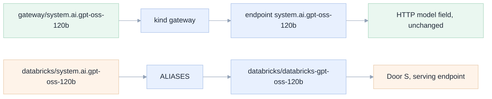
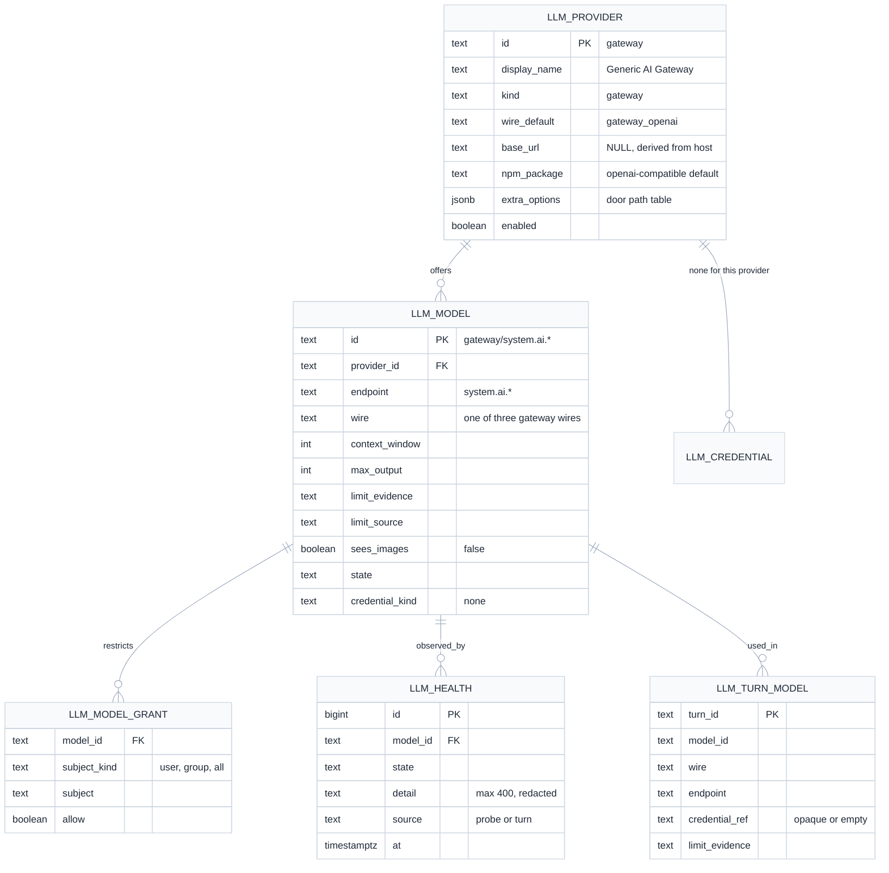

# 05 — Data model

[Index](README.md) · prev: [04 Provider contract](04-provider-contract.md) · next: [06 Statecharts](06-statecharts.md)

The tables already exist (`apps/coding-agent/api/adapters/llm/store/migrations/001_llm_schema.sql`
and `003_llm_model_vision.sql`). This provider adds rows and two enum values.
It does not add a table. A new table would duplicate `llm_provider` and `llm_model`.

## Identity

| Catalogue id | Kind | Endpoint stored | Door |
|---|---|---|---|
| `gateway/system.ai.gpt-oss-120b` | `gateway` | `system.ai.gpt-oss-120b` | OpenAI |
| `gateway/system.ai.gpt-oss-20b` | `gateway` | `system.ai.gpt-oss-20b` | OpenAI |
| `gateway/system.ai.qwen3-next-80b-a3b-instruct` | `gateway` | same | OpenAI |
| `gateway/system.ai.llama-4-maverick` | `gateway` | same | OpenAI |
| `gateway/system.ai.claude-sonnet-4-5` | `gateway` | same | Anthropic |
| `gateway/system.ai.gemini-3-flash` | `gateway` | same | Gemini, not selectable |

The Gemini id is a catalogue placeholder for the gated family named in §3.2
(`system.ai.gemini-*`). The exact enabled name was not captured. The row's
endpoint is not sent until a capture names it. Until then `refusal` is set and
`enabled` stays true so the picker can explain the gate. If that placeholder
id is too specific for an uncaptured name, the seed omits the row entirely and
the picker has nothing to show. This specification omits the Gemini row from
the seed and records the family as a refusal cause without an id. A named
capture adds one row later. That is P6 applied to identity: no invented model id.

Claude's captured failing names were `system.ai.claude-sonnet-4-6` and
`databricks-claude-sonnet-4-6`. The serving catalogue already has
`databricks-claude-sonnet-4-5` with state `not_enabled`. The gateway seed uses
`system.ai.claude-sonnet-4-5` only because the serving row documents that
generation. The probe, not the seed, decides if this workspace serves it.
A 404 or `ENDPOINT_NOT_FOUND` sets `not_served` and the row leaves the
selectable set. It is not rewritten to `-4-6`.

## Logical model

`LLM_CREDENTIAL` is drawn to show the absence. Gateway rows use
`credential_kind = none` and `credential_source = workspace_token`. No ciphertext
is written. The unique partial index "one live key" is not involved. Putting the
workspace token in `llm_credential` would create a second copy of a secret the
platform already injected, which breaks P4.

`extra_options` on the provider holds the path table from
[04](04-provider-contract.md#ports) and `"operator": "databricks"`. The check
`provider_no_key` rejects a value whose text contains `sk-`. The token must not
be placed there. Tests insert the intended JSON and assert the check still
allows it, and insert a value containing `sk-` and assert the check rejects it.

`base_url` stays null. A host written into the row would pin a workspace that
has moved, which is why the Databricks seed omits `base_url`. The https check
allows null.

## Seed rows

| id | wire | context | output | evidence | source | capability | sees_images | initial state |
|---|---|---|---|---|---|---|---|---|
| `gateway/system.ai.gpt-oss-120b` | `gateway_openai` | 128000 | 25000 | context `documented`, output `measured` | template; §3.2 error | `tools` | false | `unknown` |
| `gateway/system.ai.qwen3-next-80b-a3b-instruct` | `gateway_openai` | 128000 | 10000 | same split | template; §3.2 error | `tools` | false | `unknown` |
| `gateway/system.ai.llama-4-maverick` | `gateway_openai` | 128000 | 8192 | same split | template; §3.2 error | `tools` | false | `unknown` |
| `gateway/system.ai.gpt-oss-20b` | `gateway_openai` | 64000 | 4000 | `default` | assumed | `tools` | false | `unknown` |
| `gateway/system.ai.claude-sonnet-4-5` | `gateway_anthropic` | 200000 | 16000 | `documented` | the serving row's Anthropic citation, not a gateway measurement | `tools` | false | `not_enabled` |

One evidence column cannot say "context documented, output measured". The
existing column is a single `limit_evidence`. The honest value for the three
measured-output rows is `measured`, because the dangerous number is output and
that number was measured. Context is then over-claimed if a reader treats the
column as covering both.

The seed therefore stores context 128000 and output as measured, and `limit_source`
is the error phrase plus the template path, in one string a person can read.
The picker already shows evidence. [07](07-ux-wireframes.md) shows the source
string, not a badge that says both numbers were measured. A schema split into
two evidence columns is not part of this work: it would change every provider's
row for one caveat. The source string carries the caveat.

`gpt-oss-20b` stays on the default pair. Promoting it to 128000/24000 because
the serving twin has those numbers is the copy this table exists to prevent.

Claude's context and output are the documented Anthropic figures already stored
on `anthropic/claude-sonnet-4-5` and on the serving twin. Evidence is
`documented`. State starts at `not_enabled` so a workspace that has not probed
does not offer it. A 2xx probe may move it to `available`. An
`ENDPOINT_NOT_FOUND` probe moves it to `not_served`.

Capability is `tools` because tool calls were part of the captured OpenAI
sessions. `tools_and_reasoning` is not copied from the serving gpt-oss row.
That flag was not observed on Door G.

`group_name` is `Generic AI Gateway`. It is a picker group, not a wire.

Grants: no seed rows. No rows means open, which is the current product rule in
`Grant.allows`. An administrator can add a deny later. The gateway provider
does not special-case grants.

## Health and turns

`llm_health` is append-only. A probe inserts a row. A turn whose provider text
matches `cap_exceeded` inserts a row and may update `llm_model.max_output`
downward inside the existing limit transaction, never upward, and never below 1.
The check `max_output <= context_window` stays.

`llm_discovery_run` is not written by this provider until a list API exists.
Writing `ok` with `models_seen = 0` would look like an empty workspace. Omitting
the run is the accurate record.

`llm_turn_model.provider_id` is `gateway`. `wire` is the door. `endpoint` is the
UC name. `credential_ref` is `workspace-token`, the same audit token
`_workspace_ref` already writes for a Databricks model. It is not a secret and
it is not empty: an empty ref would make a gateway turn look like a model that
had no credential at all.

## Migration

Forward-only and idempotent, next to the existing chain:

1. No `ALTER` of columns.
2. The application enum `ProviderKind` and `WireProtocol` grow the new values.
   The database stores them as text. The model `wire` column has no enum check.
   The provider row is inserted by the seed upsert, which is already idempotent.
3. A test database that already has the old seed gains the new provider and the
   new models on the next seed, and does not lose serving rows.

`sees_images` stays false. Migration 003's `UPDATE ... WHERE id IN (...)` list
does not include `gateway/` ids, so a re-run cannot flip them.
