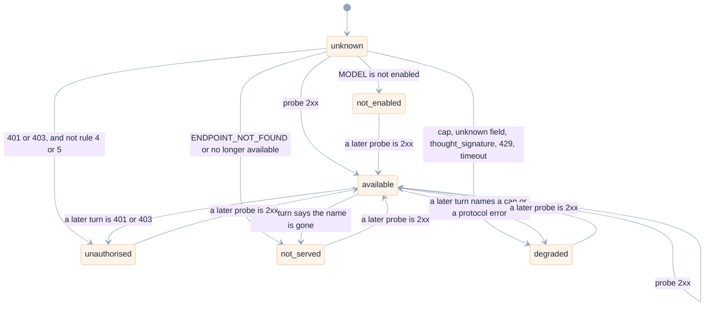
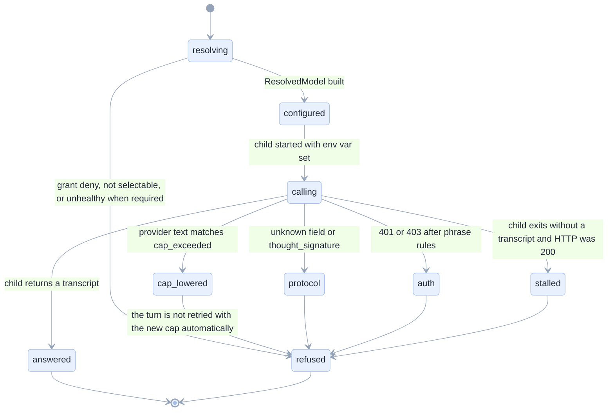
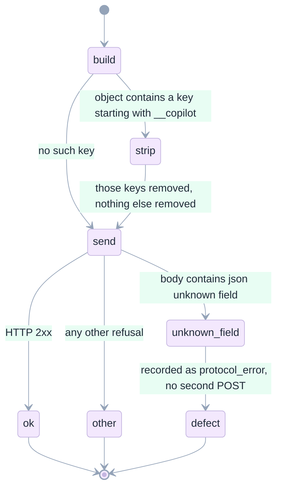
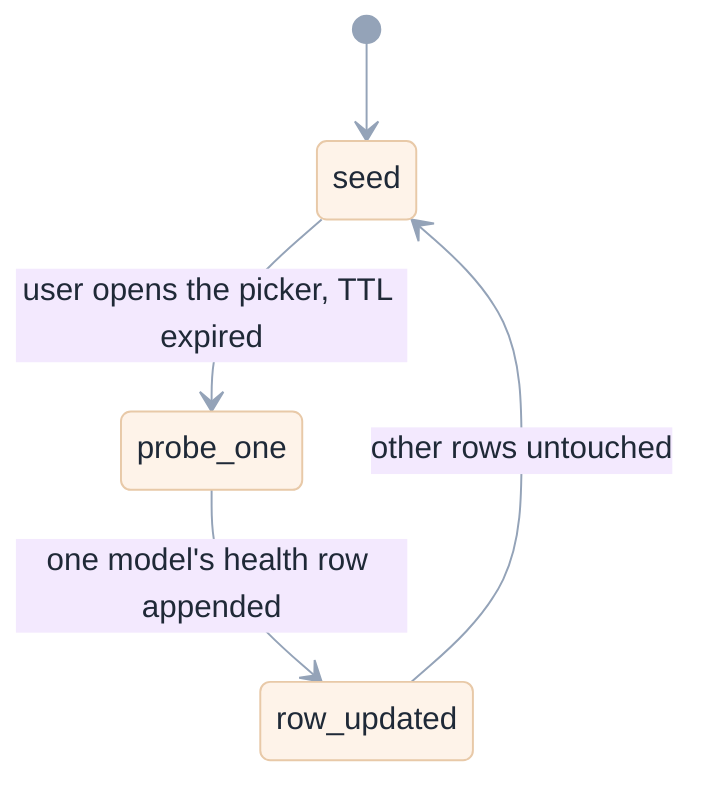
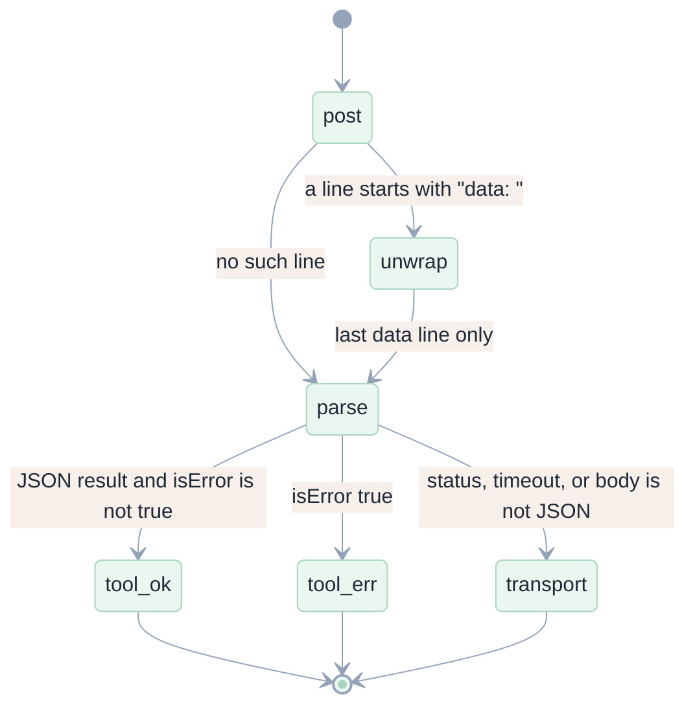

# 06 — Statecharts

[Index](README.md) · prev: [05 Data model](05-data-model.md) · next: [07 UX wireframes](07-ux-wireframes.md)

States use the names `ModelState` already stores. A transition that is not drawn
does not happen. Color repeats the label: mint is usable, amber is degraded or
unknown, rose is refused, lavender is a gate that an admin can open.

## Model health

`unknown` is usable (`ModelState.usable`). `not_enabled` and `not_served` are
not selectable. `degraded` is not usable when the session requires a healthy
model (`may_use(..., require_healthy=True)`). The picker still shows it, with
the detail, so the person can pick a different row. Gemini rows are not in this
chart because they are not seeded ([05](05-data-model.md#identity)).

A cap transition to `degraded` also writes a lower `max_output` when
`cap_from_error` returns a positive integer smaller than the stored output.
If the named number is greater than or equal to the stored output, the health
row is still written and the number is not stored. That prevents a proxy phrase
from raising a cap (P6).

## One turn

The cap is lowered for the next session. The current turn is refused rather than
retried, because a silent retry would spend the user's wait twice and the child
has already shown a failure. The copy says the limit was reduced and the next
message can be sent. See [07](07-ux-wireframes.md#copy).

`stalled` is the §4.10 observation: exit 0, no prose, HTTP 200. It is not a
gateway state change. The model stays `available`. The turn is refused as a
product stall, using the existing stall cause if the child text matches, and
`unknown` if it does not. The provider does not invent a retry.

## Strict body

There is no edge from `unknown_field` back to `strip`. That edge is how a client
hides a field it should never have sent. The only strip is the one before the
first POST, and only for the captured prefix.

## Discovery, when a list API still does not exist

There is no transition called "replace catalogue". Serving discovery's failure
modes (`denied`, `error`, cache 300 seconds, do not cache a denial) apply on
the day a list URL is captured. They are not simulated by calling the serving
list and filtering names that contain `system.ai`.

## MCP call

`tool_err` returns the tool payload to the caller. It does not change model
health. `transport` is the MCP port's error. It does not mark
`gateway/system.ai.gpt-oss-120b` degraded. The doors are independent (P9).
