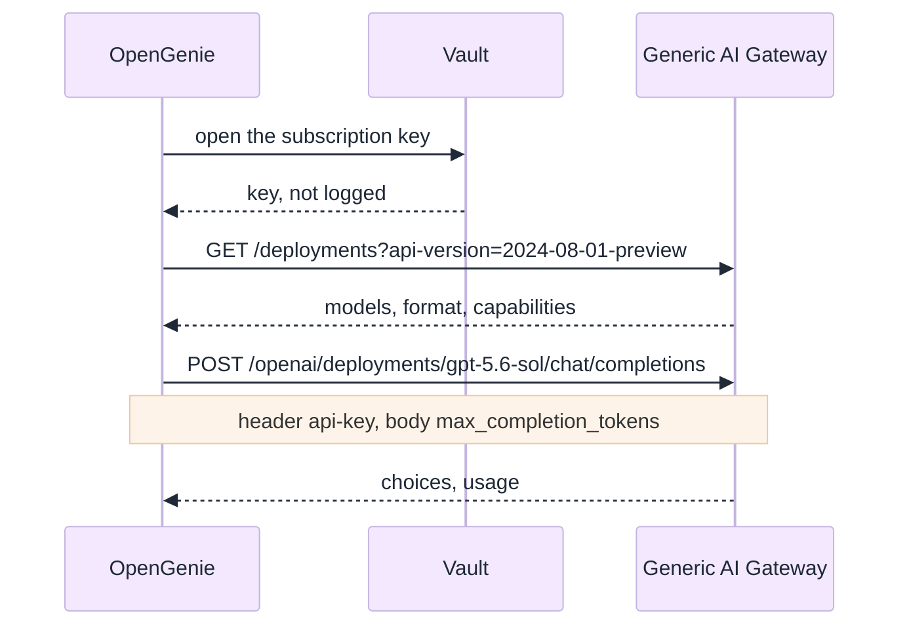

# 12 — Client wire to implement

[Index](README.md) · prev: [11 Tests](11-tests-traceability.md)

This is the provider to build. [03](03-protocol.md) and the Databricks steps in
[10](10-implementation-plan.md) are a different door.

## One screen

| | |
|---|---|
| Front door | Azure API Management. Production base `https://apim-genaigw.lpl-cloud.com/gaia`. The base is configuration. Do not hardcode it |
| Auth | Header `api-key`. Not `Authorization: Bearer`. Not `DATABRICKS_TOKEN` |
| Chat | `POST {base}/openai/deployments/{deployment}/chat/completions?api-version=2024-08-01-preview` |
| Chat body | `messages`, `max_completion_tokens`. The deployment name is in the path, not in the body |
| Claude | `POST {base}/anthropic/v1/messages`, plus `anthropic-version: 2023-06-01`. No `temperature` |
| List models | `GET {base}/deployments?api-version=2024-08-01-preview`. Read `models`, not `data` |
| Embeddings | `POST {base}/openai/deployments/text-embedding-3-large/embeddings?api-version=2024-08-01-preview` |
| In OpenGenie | Kind `gateway`, credential `api_key` in the vault, external. Selectable only when external providers are on and a key exists |
| Do not touch | `DatabricksAdapter`, the serving golden file, the product default model |

The file paths below are in the 17 Nov 2026 client tree, not in the OpenGenie
repository.

Source of the bytes, read in full for the client and the router:

- `src/agents/provider_routing.py`
- `src/agents/llm_client.py`
- `src/agents/config.py` (base URL, API version, circuit breaker, model list)
- `src/tools/gaia_api.py` (`_probe_gateway_models`, `_gaia_request`, `_handle_gaia_error`)
- `src/tools/llm_tool.py` (the Azure client wrapper)
- `tests/test_provider_routing.py`, `tests/test_llm_client_stream.py`
- `config/agent.yaml` for model names and the URL shape only

The tree is the 17 Nov 2026 client. No key from that tree is copied here.
`config/agent.yaml` and the hardcoded key table in `src/agents/config.py` contain live
subscription keys in the download. OpenGenie must not read those files for a
secret. The keys should be rotated. The only acceptable source is an
environment variable or the existing vault.

## Known provider

| Layer | Identity | Where |
|---|---|---|
| Front door | Azure API Management. Host `apim-genaigw.lpl-cloud.com`, plus `int-apim-genaigw.lpl-cloud.com` for UAT | URL table in `src/agents/config.py` |
| Protocol | Azure OpenAI deployments. Query `api-version=2024-08-01-preview`. Header `api-key`, not `Authorization` | `build_openai_chat_url`, `tests/test_provider_routing.py` |
| Default upstream format | OpenAI. Unrecognised deployment names are treated as OpenAI | `detect_provider_by_name` |
| Other formats on the same door | `anthropic`, `google`, `DeepSeek`, `xAI`, `Mistral AI` | `_FORMAT_PATTERNS` and the comment in `_gaia_request` |
| What it is not | Databricks Model Serving, and not `{workspace}/ai-gateway/openai/v1` | no such path in this client |

Captured bases, path only. The host is configuration, not a constant in OpenGenie:

| Environment | Base |
|---|---|
| UAT | `https://int-apim-genaigw.lpl-cloud.com/uat/gaia` |
| OAT | `https://apim-genaigw.lpl-cloud.com/oat/gaia` |
| PRD | `https://apim-genaigw.lpl-cloud.com/gaia` |

The client resolves an environment variable, then the yaml, then the table above. OpenGenie reads `APP_LLM_GATEWAY_BASE_URL` or `XAIA_BASE_URL` and drops the yaml and the hardcoded table. A missing base is a configuration error, not a silent production URL.

## Chat, OpenAI-shaped deployments

Used for every format except Anthropic, including Google, DeepSeek, xAI, and Mistral (`_gaia_request`).

```http
POST {base}/openai/deployments/{deployment}/chat/completions?api-version=2024-08-01-preview
api-key: <subscription key>
Content-Type: application/json

{
  "messages": [
    {"role": "system", "content": "..."},
    {"role": "user", "content": "..."}
  ],
  "max_completion_tokens": 8192
}
```

| Rule | Source |
|---|---|
| The deployment name is in the path. The body has no `model` field on this door | `call_llm_ex` non-Anthropic branch |
| The limit field is `max_completion_tokens`, not `max_tokens`. Default 8192 | `LLMConfig.max_completion_tokens` |
| `api-key` is the only credential header. `Authorization` is absent | provider-routing test |
| `temperature` is sent only when the caller set it and the deployment is not a reasoning model | `call_llm_ex` |
| `reasoning_effort` is sent only when the caller set it and the deployment is in the reasoning set | same |
| Reasoning set shipped in code: `o3`, `o3-mini`, `gpt-5.5`, `gpt-5.6-sol`, plus any deployment that returned HTTP 400 `error.code=unsupported_value` and `error.param=temperature` | `LLMConfig.reasoning_models`, `_is_temperature_rejection` |
| `response_format` is optional. First try is `json_schema` with `strict: true`. A 400 or 422 retires that mode for the process and the next call uses `{"type":"json_object"}` | `call_llm_structured` |
| Strict schemas must set `additionalProperties: false` and list every property in `required`. A free-form map is sent as an array of `{key, value}` | `_make_strict_schema` |
| Retry statuses: 429, 500, 502, 503, 504. Backoff `2 * 2^attempt` seconds, three retries after the first try (`max_retries` 3). Timeout 180s | `call_llm_ex`, `LLMConfig` |
| 401, 403, 405, and 400 are not retried. 405 means this key may not call that deployment | `_handle_gaia_error` |
| After five consecutive failures the circuit opens for 60 seconds. One probe is allowed when the cooldown ends | the client's circuit breaker |
| A thinking model may return `choices[0].message.content = null` while `usage.completion_tokens_details.reasoning_tokens` is non-zero. That is an empty answer, not a transport error | `call_llm_ex` |
| Usage fields read: `prompt_tokens`, `completion_tokens`, `total_tokens`, `completion_tokens_details.reasoning_tokens`, `prompt_tokens_details.cached_tokens` | `_last_usage` |

`llm_tool.py` builds the same URL through `AzureChatOpenAI` with `azure_endpoint` equal to the base, `azure_deployment` equal to the deployment name, the same api version, and `default_headers` `api-key`. That wrapper also sets `temperature: 1`. The agent client does not. OpenGenie follows `call_llm_ex`, not the tool wrapper's temperature.

## Streaming

Non-Anthropic stream body adds `"stream": true` and `"stream_options": {"include_usage": true}`. The response is SSE:

- lines `data: {json}`
- a later chunk may contain `usage` and empty `choices`
- the stream ends with `data: [DONE]`
- content is `choices[0].delta.content`

Anthropic stream uses the messages URL below and the event types `message_start`, `content_block_delta`, `message_delta`, `message_stop`. Text is `delta.text`. Usage maps `input_tokens` to `prompt_tokens` and `output_tokens` to `completion_tokens`.

Connect timeout on the stream client is 10 seconds. The read timeout is the call timeout.

## Anthropic deployments

Name pattern `^claude`, or `format` from the deployments list equal to `anthropic` (the list wins when it is cached).

```http
POST {base}/anthropic/v1/messages
api-key: <subscription key>
Content-Type: application/json
anthropic-version: 2023-06-01

{
  "model": "claude-sonnet-5",
  "max_tokens": 8192,
  "system": "...",
  "messages": [{"role": "user", "content": "..."}]
}
```

`temperature` is omitted. The door returns 400 "temperature is deprecated for this model" for newer Claude deployments. `system` is a top-level string, not a message. The response is normalised: `content[].text` becomes `choices[0].message.content`, `stop_reason` becomes `finish_reason`, `input_tokens` / `output_tokens` become the OpenAI usage names. There is no `response_format` on this door.

## Embeddings

```http
POST {base}/openai/deployments/text-embedding-3-large/embeddings?api-version=2024-08-01-preview
api-key: <subscription key>
Content-Type: application/json

{"input": "<text>", "model": "text-embedding-3-large"}
```

The vector is `data[0].embedding`. Expected length 3072. A different length is a warning in the client, and the vector is still returned. A failure returns no vector. OpenGenie records the failure and does not invent a vector. Timeout 30 seconds. This call does not use the circuit breaker in the client; OpenGenie should use the same breaker as chat so a dead door does not keep embedding.

## Discovery

```http
GET {base}/deployments?api-version=2024-08-01-preview
api-key: <subscription key>
```

The body is `{"models":[...]}`, not the Azure `{"data":[...]}`. Each item uses `name` or `id`, `model_name`, `format` (default `OpenAI`), and `capabilities`.

| Capability | Meaning |
|---|---|
| `reasoning` | do not send `temperature`; `reasoning_effort` is allowed |
| `embeddings` | embedding deployment, not a chat model |

`GET {base}/openai/models` returns 404 on this gateway. It is only a fallback in the comment. OpenGenie does not call it.

Config models win over the list on the same deployment name (`_merge_models`). A denial or a transport error leaves the configured rows in place. An empty 200 is a real empty list.

## Deployments the yaml offers for chat

| Display | Deployment | Tier in the client | Format |
|---|---|---|---|
| GPT 5.6 Sol | `gpt-5.6-sol` | strong, and the dropdown default | OpenAI, reasoning |
| Terra | `gpt-5.6-terra` | fast | OpenAI |
| Luna | `gpt-5.6-luna` | fast | OpenAI |
| Claude Sonnet 5 | `claude-sonnet-5` | strong | Anthropic by name |

`LLMConfig.default_model` is still `gpt-5.5`. Tests in this tree record that name as retired: the door answers 405. OpenGenie does not seed `gpt-5.5`. The selectable default is `gpt-5.6-sol`.

Output caps for these deployments were not named by an error in this tree. The client sends 8192 unless a task budget overrides it (512, 1024, 4096, 8192). OpenGenie stores output 8192 with evidence `documented` and source `LLMConfig.max_completion_tokens`, and lowers it only when an error names a smaller ceiling.

## Sequence



A Claude deployment replaces the POST with `/anthropic/v1/messages` and adds `anthropic-version`. The serving adapter is not on this diagram.

## What OpenGenie changes, and what it does not

This provider is external. `llm_allow_external` false must keep refusing it, with the sentence the catalogue already uses. It does not join `is_workspace_native`. It does not use `DATABRICKS_TOKEN`. The health probe opens the vault key for this kind. `secret is None` returns `unauthorised` and does not POST.

| Piece | Choice |
|---|---|
| Kind | `gateway` |
| Wires | `gateway_openai`, `gateway_anthropic`, `gateway_embed` |
| Credential | `api_key`, vault, variable `LLM_PROVIDER_KEY` |
| Header on the probe and on the agent file | `api-key: {env:LLM_PROVIDER_KEY}` |
| Base | operator-configured `https` URL, no trailing slash, no hardcoded host |
| App client | The proven path. It posts the deployments URL itself, with header `api-key` |
| Agent npm | `@ai-sdk/azure`, `baseURL` `{base}/openai`, `apiVersion` `2024-08-01-preview`. `@ai-sdk/openai-compatible` posts `{baseURL}/chat/completions` with `Authorization: Bearer` and a body `model` field, which is a different request |
| Anthropic npm | The app client posts `/anthropic/v1/messages`. The agent block uses `@ai-sdk/anthropic` with `toolStreaming: false` and header `api-key`. That block is unverified until a recorded request matches the app client |
| Default model | unchanged. `gpt-5.6-sol` is not the product default |
| Serving golden file | untouched |
| Discovery of serving endpoints | untouched. It does not see these rows because the kind is not `databricks` |

The app client posts `{base}/openai/deployments/{deployment}/chat/completions?api-version=2024-08-01-preview`. The deployment name is in the path. The agent file's `baseURL` is `{base}/openai` with `apiVersion` `2024-08-01-preview` and npm `@ai-sdk/azure`, so the package can put the deployment in the path. A file that uses `@ai-sdk/openai-compatible` posts `{baseURL}/chat/completions` with a body `model` field. That request is not this client. `AzureChatOpenAI` in `llm_tool.py` uses the deployments form. The agent path is finished only when a recorded request matches that form. The plan's roadblock R6 states the same gate.

Picker group `Generic AI Gateway` stays second, tag `catalog`. Rows are not selectable until a key exists (`needsKey`). Copy for 405: `This key cannot call {deployment}.` Copy for an open circuit: `The gateway is paused after repeated failures. Wait a minute and try again.`

## Edge cases this client adds

| Id | Case | Mitigation | Test |
|---|---|---|---|
| E-43 | Implementer follows [03](03-protocol.md) and posts to `/ai-gateway/openai/v1` with a bearer token | The probe URL in the golden file is the deployments URL and the header name is `api-key` | T-19 |
| E-44 | Body uses `max_tokens` | Body key is `max_completion_tokens` | T-19 |
| E-45 | `gpt-5.5` seeded from `LLMConfig.default_model` | Not seeded. 405 is `unauthorised` for that deployment, not a dead gateway | T-20 |
| E-46 | Temperature sent to `gpt-5.6-sol` or `claude-sonnet-5` | Omitted. A 400 `unsupported_value` on `temperature` adds the deployment to the reasoning set and is not retried with the same body | T-20 |
| E-47 | `GET /openai/models` used as discovery | Not called. Discovery is `GET /deployments` and reads `models` | T-21 |
| E-48 | Key taken from the downloaded yaml or the hardcoded key table | Those values are never read. Missing env and missing vault row is `unauthorised` with no POST | T-26 |
| E-49 | Circuit opens and the next chat still POSTs | Five failures open it. The next call raises before HTTP until 60 seconds have passed, then one call is allowed | T-22 |
| E-50 | Strict schema has optional fields or a free-form object | Patched to `additionalProperties: false`, every property required, maps as `{key, value}` arrays, decoded on the way back | T-23 |
| E-51 | Stream usage chunk has no `choices` | Parser keeps the usage and does not drop the stream. `[DONE]` ends it | T-24 |
| E-52 | External providers disabled | Row remains, `selectable` false, existing disabled sentence. Serving models unchanged | T-25 |

## Tests to add

| Id | Assert |
|---|---|
| T-19 | Recorded probe is `POST {base}/openai/deployments/gpt-5.6-terra/chat/completions?api-version=2024-08-01-preview` with header `api-key` and body keys `messages` and `max_completion_tokens` only |
| T-20 | `claude-sonnet-5` posts to `{base}/anthropic/v1/messages`, body has `model`, `max_tokens`, `messages`, no `temperature`. `gpt-5.5` is absent from the seed |
| T-21 | Discovery GET path is `/deployments`, and a body `{"models":[{"name":"gpt-5.6-luna","format":"OpenAI","capabilities":[]}]}` becomes one catalogue row. A 404 from `/openai/models` is not requested |
| T-22 | The sixth call after five 503s does not open a socket. A call after the cooldown does |
| T-23 | A schema with an optional field and a `dict[str, str]` is patched, and the array form decodes back to a dict |
| T-24 | SSE fixture from `tests/test_llm_client_stream.py` (`data:` chunks, a usage chunk, `data: [DONE]`) yields the text and the usage |

T-25 through T-30 cover the OpenGenie seams (external flag, vault key, agent file, serving discovery, picker, embeddings). They are listed in [11](11-tests-traceability.md#client-tests) and mapped to roadblocks in [10](10-implementation-plan.md#roadblocks).

Serving tests T-01 and the Databricks golden file stay as they are. They guard the other door.
