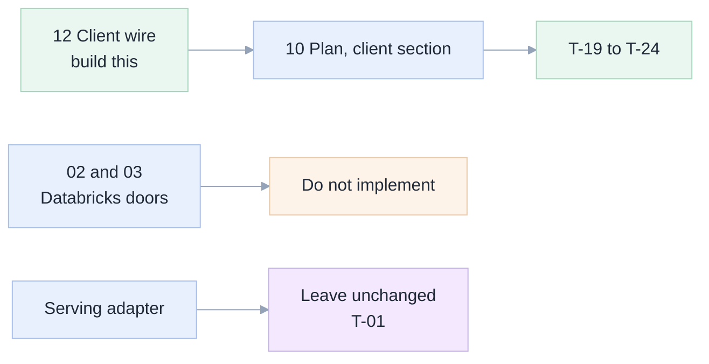

# 07 — Generic AI Gateway provider

Status: **implemented** in the Databricks app. Operators start at
[13 — Configuration](13-configuration.md).

The wire is [12 — Client wire](12-client-wire.md). The other documents explain
OpenGenie as it is, so this provider is not pointed at the wrong host.

## Three doors, one of them to build

| Door | Who | Request | Build it? |
|---|---|---|---|
| Model Serving, already in OpenGenie | Databricks | `POST {workspace}/serving-endpoints/{name}/chat/completions` with `Authorization: Bearer` | No. Leave `DatabricksAdapter` as it is |
| Databricks AI Gateway, measured in this repo | Databricks | `POST {workspace}/ai-gateway/openai/v1/chat/completions` with `Authorization: Bearer` and a `system.ai.*` model | No. Documented in [03](03-protocol.md) so it is not confused with the client |
| Generic AI Gateway, the 17 Nov 2026 client | Azure API Management (`apim-genaigw.lpl-cloud.com`) | `POST {base}/openai/deployments/{deployment}/chat/completions?api-version=2024-08-01-preview` with header `api-key` | **Yes.** [12](12-client-wire.md) |

The third door is not a Databricks workspace. Its default upstream format is
OpenAI. The same host also serves Anthropic, Google, DeepSeek, xAI, and Mistral.
A name it does not recognise is sent down the OpenAI path.

## Do not mix these requirements

`GW-01`–`GW-22` in [04](04-provider-contract.md) describe the Databricks door.
Several of them are the opposite of the client. Implementing them will not
reach the client.

| Databricks requirement | What it would send | What the client requires |
|---|---|---|
| GW-01 | `/ai-gateway/openai/v1` | `/openai/deployments/{deployment}/chat/completions` |
| GW-04, GW-16, GW-21 | `Authorization: Bearer` and `DATABRICKS_TOKEN` | header `api-key`, a vault subscription key |
| GW-05 | body keys `model` and `max_tokens` | no `model` in the body; `max_completion_tokens` |
| GW-19 | selectable with external providers off | refused when external providers are off |

Client risks are `E-43`–`E-52` and tests `T-19`–`T-24` in [12](12-client-wire.md).
`E-01`–`E-42` belong to the Databricks study.

## What to read

| If you are… | Read |
|---|---|
| Configuring the app | [13](13-configuration.md) |
| Checking the wire | [12](12-client-wire.md) |
| Checking you did not break serving | [04](04-provider-contract.md) GW-11 only, and test T-01 |
| Understanding why OpenGenie already says "gateway" | [02](02-code-grounding.md) and [03](03-protocol.md). Stop there. Do not code from them |

| Document | Role |
|---|---|
| [01 — Five whys](01-five-whys.md) | Why a second provider exists at all |
| [02 — Code grounding](02-code-grounding.md) | OpenGenie today. Background |
| [03 — Protocol](03-protocol.md) | Databricks `/ai-gateway` wire. Background |
| [04 — Provider contract](04-provider-contract.md) | Databricks requirements `GW-*`. Background, except GW-11 |
| [05](05-data-model.md) through [09](09-edge-cases.md) | Catalogue, states, screens, and Databricks edge cases. Background |
| [10 — Plan](10-implementation-plan.md) | The build. One roadblock table, then phases P0–P5. The Databricks steps are withdrawn |
| [11 — Tests](11-tests-traceability.md) | T-01 guards serving. T-19–T-24 guard the client |
| [12 — Client wire](12-client-wire.md) | **The build** |
| [13 — Configuration](13-configuration.md) | The variables a Databricks app sets |

## Diagram convention

ASCII wireframes use printable ASCII. Mermaid diagrams use pastel blue, mint,
lavender, amber, and rose with dark text. Color supplements a label. It never
carries the only meaning.

Related work that this specification does not replace:
[005 provider notes](../005-llm-models/04-providers.md),
[005 data model](../005-llm-models/05-data-model-lakebase.md),
and the measurement log in `docs/genie-code-replacement-spec.md`.
